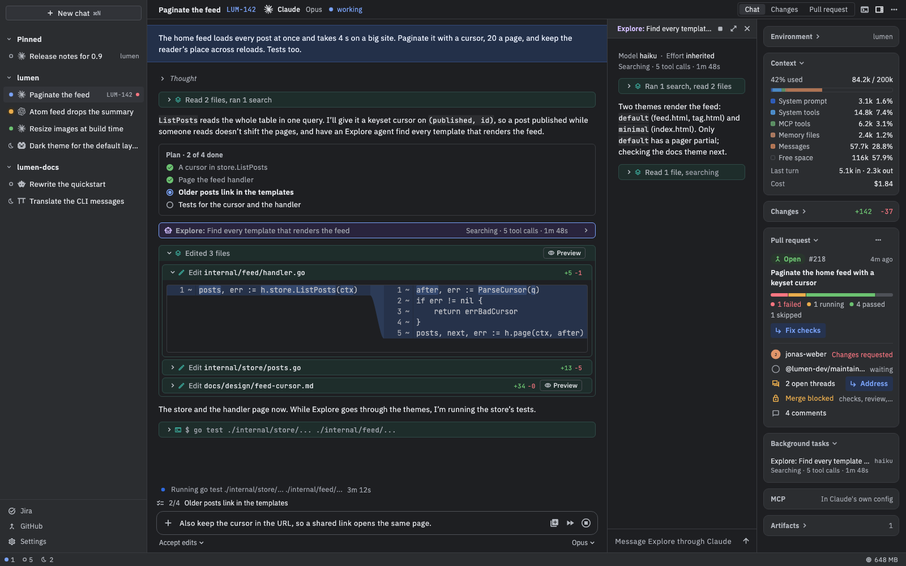
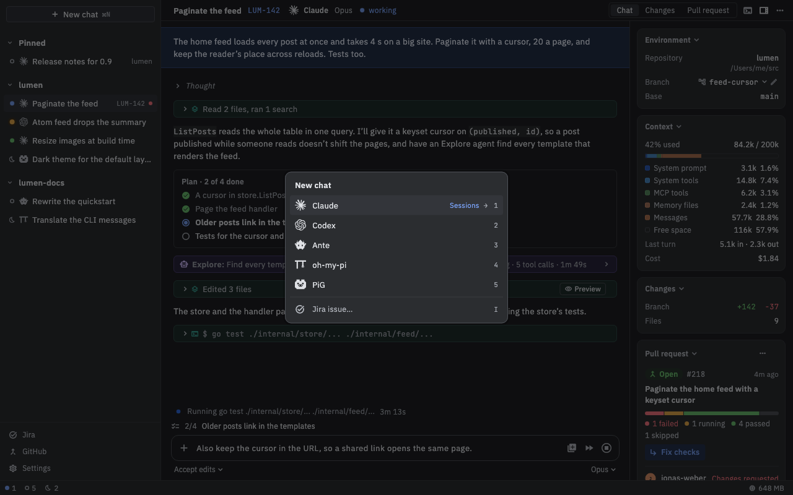
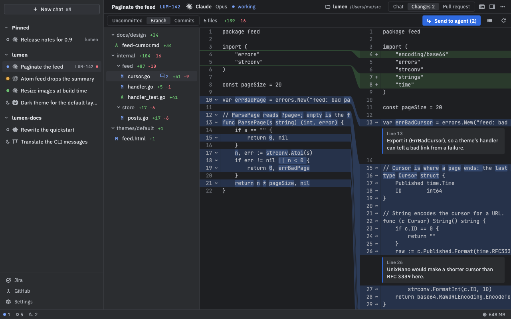
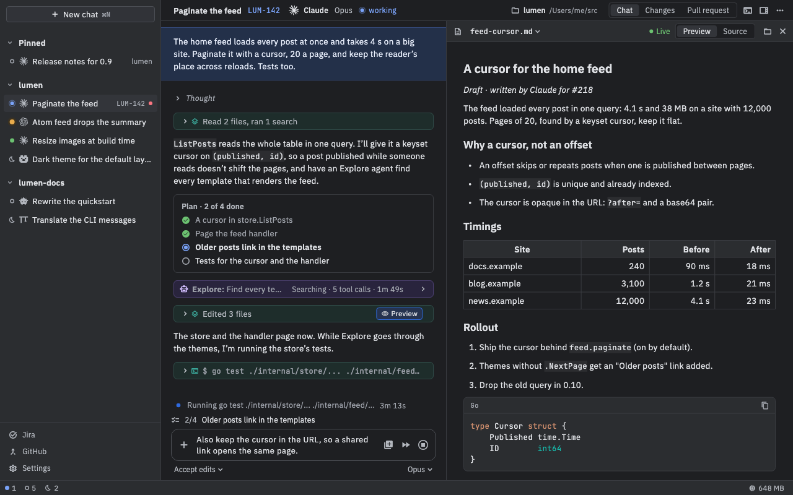
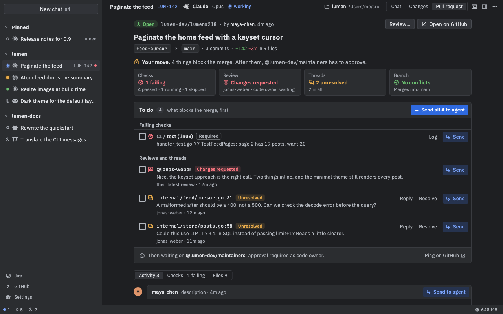
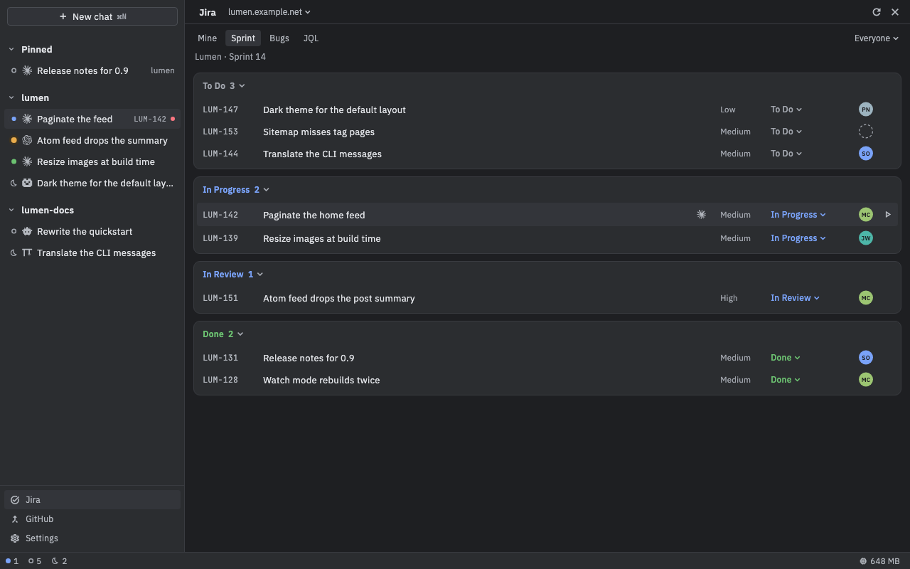
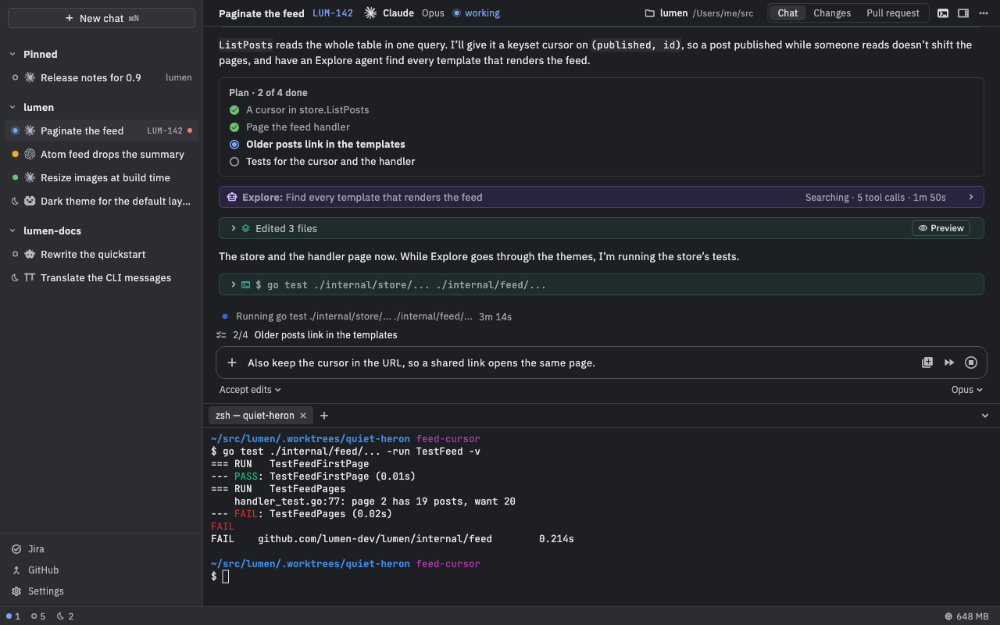
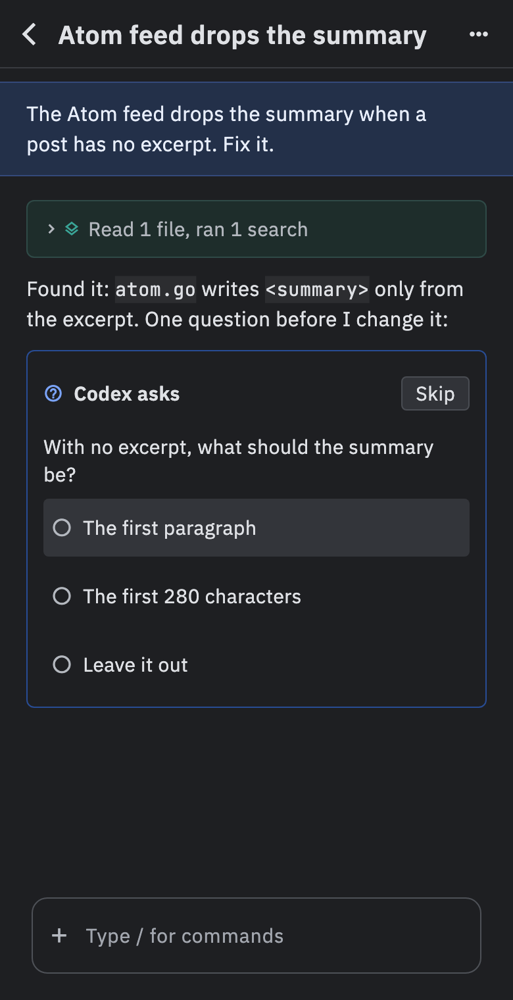

<p align="center"><picture><source media="(prefers-color-scheme: dark)" srcset="docs/brand/mark-dark.svg"></picture></p>

<h1 align="center">Nushi</h1>

<p align="center">A Mac app that runs your coding agents as chats, beside a diff viewer, your pull requests and your phone.</p>

<p align="center"><a href="#install">Install</a> · <a href="#what-it-does">What it does</a> · <a href="#docs">Docs</a> · <a href="https://github.com/afrase/nushi/releases">Releases</a></p>

<p align="center"></p>

## Install

```sh
brew install --cask afrase/tap/nushi
```

Then open Nushi and set up an agent in Settings › Agents. The zip, upgrades and uninstalling are in [Installing Nushi](docs/install.md).

## What it does

<table>
<tr>
<td width="44%"><b>Any ACP agent.</b> Claude, Codex, Ante, oh-my-pi and PiG run as chats over the <a href="https://agentclientprotocol.com">Agent Client Protocol</a>, each your own CLI with its own login and history, so a chat resumes in a terminal.</td>
<td><a href="docs/images/agents.png"></a></td>
</tr>
<tr>
<td><b>Changes and review.</b> A side-by-side diff of the chat's work, with comments on its lines that go to the agent as one message.</td>
<td><a href="docs/images/changes.png"></a></td>
</tr>
<tr>
<td><b>Artifacts and previews.</b> Markdown, HTML, images, PDFs, CSVs and Mermaid diagrams the agent writes preview beside the chat, live as it rewrites them.</td>
<td><a href="docs/images/preview.png"></a></td>
</tr>
<tr>
<td><b>The Pull request tab.</b> Checks, reviews and threads in one place, what blocks the merge first, each a click from the agent's box.</td>
<td><a href="docs/images/pull-request.png"></a></td>
</tr>
<tr>
<td><b>Jira.</b> Your issues and sprints as a task list; Start work opens a chat in a worktree named after the issue.</td>
<td><a href="docs/images/jira.png"></a></td>
</tr>
<tr>
<td><b>Terminals.</b> Shells under each chat, kept by the daemon, so they outlive the app.</td>
<td><a href="docs/images/terminal.png"></a></td>
</tr>
<tr>
<td><b>The phone.</b> Follow your chats and answer their questions from your phone, end-to-end encrypted through a relay you run.</td>
<td align="center"><a href="docs/images/phone.png"></a></td>
</tr>
</table>

## Requirements

- A Mac with Apple silicon and macOS 13 or later.
- An agent's CLI: `claude`, `codex`, `ante`, `omp` or `pig`; Claude and Codex also need Node and npm.

## Docs

- [Installing Nushi](docs/install.md): the zip, updates, uninstalling, the daemon and its logs
- [Chats](docs/chats.md): the window, keys, Changes, previews, terminals, worktrees, history, notifications
- [Agents](docs/agent-setup.md): each agent and how to set it up
- [MCP servers and skills](docs/mcp-and-skills.md)
- [Jira](docs/jira.md) and [GitHub](docs/github.md)
- [Remote access and the phone](docs/remote.md): pairing, and running your own relay
- [Development](docs/development.md): building, testing, and the decisions in [`docs/adr/`](docs/adr/README.md)

Nushi isn't affiliated with Anthropic, OpenAI, or the maker of any agent it runs.

MIT. See [LICENSE](LICENSE).
