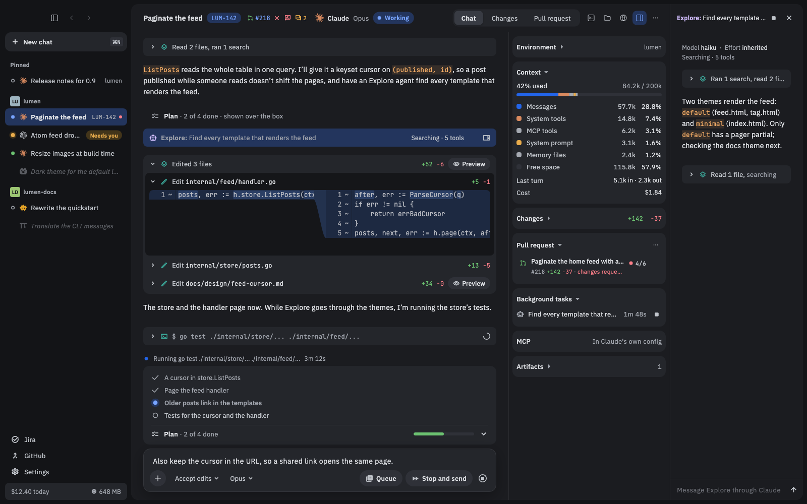

# Chats

A chat is a conversation with one coding agent, working in one folder. This page covers the everyday work: sending messages, answering the agent, and finding old chats.

The shortcuts below are the Mac's. On Linux, use Ctrl where the Mac uses ⌘.

## Start a chat

1. Press **⌘N**, or click the **+** next to a project in the sidebar.
2. Pick an agent. The one you used last is already picked.
3. Press Enter.

The sidebar lists your chats by project. Click one to open it.

## Tell projects apart

Each project in the sidebar has a small square tile before its name, so you can tell projects apart at a glance. The tile shows the repository's own icon if it has one (an `icon.png` or `logo.png`, an app's icon, a site's favicon). Otherwise it shows the folder's initials on a color.

To change a project's tile:

1. Right-click the project's name.
2. Pick **Change tile…**.
3. Type an emoji or one or two letters, pick a color, and click **Save**. **Reset** puts the tile back.

To use a picture of your own:

1. Right-click the project's name and pick **Change tile…**.
2. Click **Choose image…** and pick a PNG, JPEG, GIF or WebP file (up to 16 MB; an animated one up to 4K, 3840 × 2160).
3. To show only part of it, zoom in with the **Zoom** slider (or scroll, or pinch), then drag the picture in the square below it. The tile beside it shows the result. **Reset framing** shows the middle again.
4. To play only part of a GIF, drag the handles at the ends of the strip of frames under it. Click **Play** to watch the part you kept; drag the line between the handles to look at one frame.
5. Click **Save**.

A GIF plays while the pointer is on the tile, framed and trimmed the same way. Nushi doesn't change the picture itself, so you can frame or trim it again later. To keep every frame again, drag the handles back to the ends. To take the picture off, open **Change tile…** again, click **Remove image**, then click **Save**. Nushi keeps its own copy of the picture, so you can move or delete the file you picked.

To add a project before it has a chat, click the Arrange button at the top of the sidebar, pick **Add project…** and pick its folder.

## Hide the sidebar

Press **⌘\**, or click the sidebar button at the top left of the window, to the right of the window's own buttons. The chat takes the whole window. The button stays in the same place, so the same click brings the sidebar back.

To glance at the sidebar while it's hidden, point at the sidebar button (or rest the pointer on the window's left edge). The sidebar slides in over the chat, and you can pick a chat or use its menus there. It slides away when the pointer leaves it. To keep it shown, click the button while it's out.

In a narrow window (about 600 points wide or less), the sidebar hides itself so the chat has room. It comes back on its own when the window is wider. While it's hidden this way, **⌘\** or the sidebar button slides it in over the chat, as above.

## Go back to a chat

The **<** and **>** buttons to the right of the sidebar button work like a browser's Back and Forward. **<** goes back to the chat you had open before, and **>** goes forward again. The Jira and GitHub views count as places too. Back and Forward skip a chat you've since deleted or archived.

- **⌘[**: Back (on Linux, **Alt+Left**).
- **⌘]**: Forward (on Linux, **Alt+Right**).
- **⌥⌘↑** and **⌥⌘↓**: the chat above or below in the sidebar (on Linux, **Ctrl+Page Up** and **Ctrl+Page Down**).

## See one project's chats

The project rail is a column of larger tiles at the sidebar's left, one for each project. It's off at first.

1. Open **Settings**, then **Appearance**.
2. Turn on **Project rail**.
3. Click a project's tile. The sidebar shows only that project's chats.
4. Click **All projects**, the tile at the top, to see every project again.

Your pinned chats stay at the top whichever project you pick, so you can always see them. A pinned chat from another project shows that project's tile before its title and its name after it. Opening one doesn't change the project you picked, so you can look in on it and stay where you were. To see only the picked project's pinned chats, turn off **Pinned from every project** in **Settings**, **Appearance**.

To change the projects' order, drag a tile up or down the rail. The sidebar's list takes the same order, as dragging a project's header there changes the rail.

A number on a tile counts that project's chats that need you. Hover over a tile for the project's name and folder. While the rail is on, the sidebar can't be dragged narrower than the rail needs. The rail isn't there in a very narrow window, or while the sidebar is grouped by something other than Project; its setting then says why.

## Sort a project's chats

Each project can sort its chats its own way. Projects you don't change keep the order set in the Arrange menu's **Sort by**.

1. Point at the project's name in the sidebar.
2. Click the **⇅** button beside its **+**.
3. Pick **Last updated**, **Date created**, **Name** or **Manual** (the order you drag them into), and which way.

While the project sorts its own way, the ⇅ button stays visible, in color. To go back to the sidebar's order, pick **Sidebar’s sort**.

## Find an archived chat

Archived chats wait at the bottom of the sidebar, newest archived first, so a chat you just put away is at the top of the list.

1. Click **Archived** at the bottom of the sidebar.
2. Click the chat to read it, or right-click it and pick **Unarchive**.

If you've picked a sort in the Arrange menu's **Sort by**, Archived uses it too. Chats archived before Nushi recorded archive times come after the rest, newest first.

## Change the theme

Nushi comes in a few color themes, each with a dark and a light look. Settings stays open over the window, so you see a theme on your chats as you pick it.

1. Open **Settings**, then **Appearance**.
2. Under **Theme**, pick **System**, **Light** or **Dark** beside **Mode**. **System** follows your computer.
3. Click a theme's card. The picked one has a ring and a check.

To make your own, click **New from** and the theme's name: Nushi writes a JSON file of its colors to the themes folder, which **Show folder** opens. Change the colors in the file; Nushi reads it again as you save it.

## Change the fonts

Nushi comes with its own fonts. You can use any font installed on your computer instead: one for the app's text, one for code, and one for the terminal.

1. Open **Settings**, then **Appearance**.
2. Under **Fonts**, click the menu beside **App** and pick a font. The whole window changes at once.
3. Beside **Code**, pick a font for code in chats, diffs and files.
4. Beside **Terminal**, pick the terminal's font and its size.

The list is long: type a few letters to find a font. To go back, pick the first font in the list, the one marked **bundled**. On a Mac, **System** is the font macOS itself uses.

**Settings**, then **Terminal** has the terminal's font and size too, beside a preview. The phone always uses Nushi's own fonts.

## Change a keyboard shortcut

You can give any action its own key, or none. The menu bar, the command palette and the tooltips then show your key.

1. Open **Settings**, then **Keyboard shortcuts**. To find an action, type in **Search actions and keys**: part of its name, its group, or a key as shown or in words (`cmd k`, `ctrl tab`). Esc empties the search.
2. Click the action's key, at the right of its row (or anywhere on the row). It reads **Press keys…**.
3. Press the new keys. Hold ⌘, ⌃ or ⌥ with them (Ctrl or Alt on Linux), or press a function key. Esc leaves the key as it was.

If another action has that key, the row says which: click **Take it** to move it here, or **Cancel**. A key macOS, your desktop or a text box needs is refused, with the reason under the action's name.

A key you chose is tinted in the accent colour, with an arrow beside it that puts the action's own key back. Point at a row (or Tab to it) for the **×**, which leaves its action with no key: its key then reads **None**. **Reset all to defaults** puts every key back.

Some actions have a second key, shown in their row as **Also** and the key: ⇧⌘] and ⇧⌘[ for the next and previous tab, and ⇧⌘P for the command palette. You can't change them. Each works only while its action keeps its own key: give the action another key or none, or give the second key to another action, and it stops working and goes from the row. It comes back once that's undone.

The keys at the bottom, under **Fixed**, can't be changed.

## Send a message

Type in the box at the bottom and press **⏎** to send. **⇧⏎** starts a new line.

Rather press Enter for new lines? Turn on **Enter starts a new line** in **Settings › General**. Then **⏎** starts a new line and **⌘⏎** (or the Send button) sends. This goes for every box that sends to the agent: a reply, a review comment and a subagent's box too. The phone always sends with Return.

You don't have to click the box first. Start typing anywhere in the chat and the letters go into the box. (A menu, a dialog or another text field keeps what you type.)

- **Attach files or images**: click the **+** in the box and pick **Add files or photos** (**⌘U**), drop files on the chat, or paste a picture.
- **Mention a file**: type `@` and pick one.
- **Slash commands**: type `/` to see the agent's commands.

## Send while the agent is working

You can send a message before the agent finishes. Type your message, then:

- **⏎, or the Queue button,** puts it in line, as a pill over the box. If the agent takes input while it works, it gets the message right away. Otherwise the message goes when the current turn ends. You can edit or remove a pill, or send it now.
- **⌘⏎, or the Stop and send button,** stops what the agent is doing and sends your message at once.

With **Enter starts a new line** on, **⌘⏎** queues and **⇧⌘⏎** stops and sends. The box's hint and the buttons' tooltips show the keys.

## Stop the agent

Press **Esc**, or click the round red **Stop** button at the end of the box's row. Queued messages wait until you send again.

## See how long a step took

Each step the agent takes (a tool call) has a row that ends with how long it ran, such as **12s**. While the step runs, the time counts up. A folded group of calls, such as **Ran 3 commands**, ends with the time from its first call's start to its last call's end.

- A call that asked your permission counts from when you allowed it. A call you denied shows no time.
- Nothing shows for a call that took under a second.
- Calls from before Nushi saw the chat (resumed from a terminal, or replayed by the agent) have no time.
- A call still running when the turn ends stops counting there.

A call to an MCP server's tool reads as the server and the tool, such as **github · search_issues**, in Claude and Codex chats alike. Click it to see what the agent sent (**Input**) and what came back (**Output**). Calls made while an older Nushi ran show as the agent named them until Nushi restarts on its own.

A subagent is a helper the agent starts for part of a task. Its row shows how many tools it used and the time it actually worked, such as **6 tools · 3m 12s**. Its clock stops while it waits for a message. Once a Claude subagent is done, its row also shows the tokens it used, before the time: **39 tools · 182k tokens · 7m 55s**, then a check mark. Other agents don't report tokens, so their subagents show only the tools and the time. No cost shows: Claude counts a subagent's cost in the chat's total, not on its own.

## Follow the agent's plan

When the agent keeps a to-do list, its plan stays over the box until every step is done, even after the turn ends. It shows "Plan · 2 of 5 done", a progress bar, and the steps, with a dot on the one being worked on.

- **To make it one line**, click the plan's bottom line (or press Enter on it). Collapsed, it shows the count and the step being worked on. Click it again to see every step.
- Your choice holds for every chat, and after you quit.
- On the phone the plan shows as one line. Tap it to see the steps.

In the conversation, the plan's place says "shown over the box" while it's there. Once it's done or a new plan replaces it, its card shows there again.

## Follow a workflow

Claude can run a workflow: a script that has many subagents work in phases, in the background. Its card shows in the chat where Claude started it. The chat counts as working until the workflow ends.

1. Read the card: its name, the phase it's in with its progress ("Review 5/7"), how many agents run, the tokens they've used so far, and how long it has run. No cost shows: Claude doesn't report one for a workflow. At the end a check mark says it's done; otherwise it says failed or stopped.
2. To see its phases without leaving the chat, click the card, or the chevron (›) at its start. The card opens in place: what the workflow does, then each phase with its progress and the subagents running in it. The phases still to come follow, each with an empty circle and **planned**. Click again to close it.
3. Click the pane button at the card's end to open the **Workflow pane**. It lists each phase with all its subagents, their state, tokens and time, then the phases still planned. A phase the workflow ended before reaching says **not reached**.
4. Click a subagent to read its steps. **All agents** (←) goes back.
5. To stop it, point at the card and click **Stop**, or use Stop in the pane's header.

If a workflow writes nothing for an hour, it says "no activity for 1h" and no longer counts as working. It still ends only when Claude says so.

While a workflow runs, you can't move or rewind the chat, because that would stop the workflow. Stop it first, or wait for it to end.

## Pick the mode, model and effort

The agent's own options are in the box's bottom row, after the **+**. (In a side chat and on the phone, they're under the box.)

- **First, the mode.** The agent's permission mode (for example Auto or Plan) decides what it may do without asking. It's the only permission control; Nushi has none of its own.
- **Then the model** and its effort. Click to switch models. The menu also has **Effort** and **More models**.
- **The ⋯ button** holds any other options the agent offers.

A chat remembers your picks, and a new chat starts with the ones you last picked for that agent.

## Answer the agent ("Needs you")

When the agent asks permission to run something, or asks a question, the chat **needs you**:

- A card shows in the chat: a **Permission** card with the agent's choices (such as Allow or Deny), or a question card with **Submit** and **Skip**.
- The chat's dot in the sidebar turns amber and its row says **Needs you**, and Nushi's app icon shows how many chats need you.
- If you've scrolled up, a **Needs you** chip takes you down to the card.

Nushi never answers for you.

### See every option of an answered question

Once you answer, the question card shrinks to your answers. To see everything it offered:

1. Click the answered card's title line, or the chevron at its end.
2. Each question shows in full with all its options; the ones you chose are marked, the rest are greyed.
3. Click the line again to close it.

Skipped questions open the same way. Nothing in the open card can be clicked to change an answer.

## Get notified

Nushi notifies you when a chat needs you, a turn ends, or a turn fails, and when one of Claude's workflows finishes, fails or stops. Click one to open its chat. Pick which you get, and the sound, in **Settings › General › Notifications**: a workflow that finishes goes with **A turn ends**, one that fails or stops with **A turn fails**.

## Rewind a message

Rewinding takes the chat back to just before one of your messages.

1. Point at one of your messages and click its rewind button (**Rewind to here**).
2. Click **Rewind** to confirm.

Or press **Esc** twice in the box and pick a message. That rewinds at once.

The agent forgets everything from that message on, and the message goes back in the box for you to edit. Files are not rewound: the agent's changes on disk stay.

## Fork a chat

A fork is a new chat that starts with this chat's conversation so far and then goes on separately. The original chat stays as it was.

- **Fork** in the chat's **⋯** menu (or **Fork chat** in ⌘K, or **Fork** in the phone's **⋯**) forks all of it.
- **Fork from here**, under one of the agent's messages on hover, forks up to that message.

The fork opens, and a toast says **Forked into a new chat**. If you forked by mistake, click **Undo** in the toast within ten seconds. Nushi deletes the fork and the agent's session for it, and takes you back to the chat you forked from. The original chat and its history are never touched. Once you send a message in the fork, or it starts working, Undo goes away. Delete the fork from its menu instead. If the delete fails, the toast says why and the fork stays in the sidebar.

## Ask a side question

Press **⇧⌘B** to open a **side chat** beside the main one. It knows the conversation but doesn't add to it, so you can ask "why did you do that?" without sidetracking the agent; an empty one says so. ⇧⌘B hides it again. **Keep as chat** makes it a chat of its own.

**×** ends it at once. If it has messages, Nushi archives it instead of deleting it, and a toast says **Archived side chat**:

- Click **Undo** in the toast (within ten seconds) to bring it back beside the chat, as it was.
- Later, find it in **Archived** as "Side chat of" the chat's title. Delete it there if you don't need it.

If Undo can't bring it back (the chat was deleted or archived, or has another side chat open), the toast says so.

## Work in a worktree

A worktree is a separate copy of your repository on its own branch. To keep a chat's work apart from your checkout, click **New worktree** under the box before the first message. It shows only when the chat's folder is a git repository. The chat gets its own worktree, on a new branch named after the chat. Review its work in the **Changes** tab: see [Reviewing changes](Reviewing-changes).

## Find text in a chat

Press ⌘F in a chat to find text in it, all of it, even the part of a long chat you haven't scrolled up to yet.

1. Press **⌘F**. The find bar opens at the chat's top right.
2. Type. The bar counts the matches in the whole chat ("2 of 9").
3. Press ⏎ (or ↓) for the next match, ⇧⏎ (or ↑) for the one before. Past the last it goes round to the first.
4. Press **Esc** to close it.

A match further up than what's loaded takes a moment: Nushi loads that part of the chat and goes to it. It finds in what the chat shows (messages, thoughts, tool rows and their output), not in diffs, plans or images, and ignores case.

## Find an old chat

- **⌘K** finds any chat by title.
- **Settings › Chat history** lists past chats, searchable by title and folder. Click a title to open it.
- For a session you started in a terminal, press **⌘N**, highlight the agent and click **Sessions** (or →).

## See what the agents used

Settings has a Usage page: what your chats spent and the tokens they used, by day, agent, model and project, and the chats that cost the most. Where an agent reports your account's limits (Claude's 5-hour and weekly ones), they show there too.

1. Open **Settings**, then **Usage**.
2. Pick **7 days**, **30 days**, **90 days** or **All**. Nushi remembers your pick.
3. Point at a day in the chart for its spend, tokens and turns.
4. Click a chat under **Costliest chats** to open it.

Spend is what the agent reports. On a subscription that's what the API would charge for the same tokens, not what you pay. Codex and Ante report no cost, so the page says so and counts their tokens. A limit shows as the agent last said it, and changes only while one of its chats runs. Usage counts from the first turn after you updated to a version that keeps it; turns Nushi runs out of sight, such as the Context widget's check or a workflow's agents, aren't counted. The phone doesn't have this page.

## Good to know

- **Chats belong to your agent.** Each is the agent's own session, so its own resume command, run in the chat's folder, picks it up in a terminal.
- **Quitting Nushi doesn't stop your agents.** A background helper (the daemon) keeps them and the chat's terminals running. More on terminals in [Previews and terminals](Previews-and-terminals).
- **The card at the bottom of the sidebar** counts the agents that are working, awake and asleep, and shows how much memory Nushi uses. Click the memory to see each awake chat's share, with **Sleep** beside it.
- **Idle chats sleep** after 30 minutes: the agent stops, and your next message wakes it. A sleeping chat's row in the sidebar has no dot and is faint and in italics (unless a turn it finished is still unseen); its header says **Asleep**. Change it in **Settings › General › Sleep idle chats**.
- **Old chats stay asleep after Nushi restarts.** Looking at one doesn't start its agent. Your next message does. A chat you used in the hour before the restart wakes when you open it.
- **Rewind, forks and side chats** show only for agents that support them.
- **Don't use a session in Nushi and a terminal at once.** Both would write to it.
