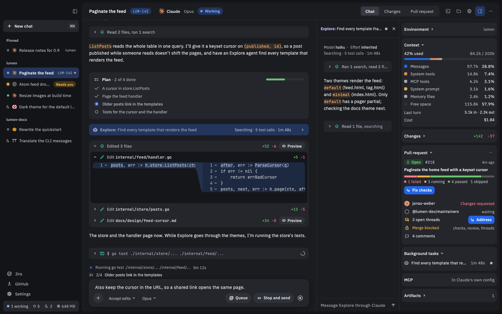

# Chats

A chat is a conversation with one coding agent, working in one folder. This page covers the everyday work: sending messages, answering the agent, and finding old chats.

The shortcuts below are the Mac's. On Linux, use Ctrl where the Mac uses ⌘.

## Start a chat

1. Press **⌘N**, or click the **+** next to a project in the sidebar.
2. Pick an agent. The one you used last is already picked.
3. Press Enter.

The sidebar lists your chats by project. Click one to open it.

## Tell projects apart

Each project in the sidebar has a small square tile before its name. It shows the repository's own icon when it has one (an `icon.png` or `logo.png`, an app's icon, a site's favicon), and otherwise the folder's initials on a color.

To change a project's tile:

1. Right-click the project's name.
2. Pick **Change tile…**.
3. Type an emoji or one or two letters, pick a color, and click **Save**. **Reset** puts the tile back.

To add a project before it has a chat, click the Arrange button at the top of the sidebar, pick **Add project…** and pick its folder.

## See one project's chats

The project rail is a column of larger tiles at the sidebar's left, one for each project. It's off at first.

1. Open **Settings**, then **Appearance**.
2. Turn on **Project rail**.
3. Click a project's tile. The sidebar shows only that project's chats.
4. Click **All projects**, the tile at the top, to see every project again.

A number on a tile counts that project's chats that need you. Hover over a tile for the project's name and folder. The rail goes when the sidebar is dragged narrow, and it isn't there while the sidebar is grouped by something other than Project.

## Send a message

Type in the box at the bottom and press **⏎** to send. **⇧⏎** starts a new line.

- **Attach files or images**: click the **+** in the box and pick **Add files or photos** (**⌘U**), drop files on the chat, or paste a picture.
- **Mention a file**: type `@` and pick one.
- **Slash commands**: type `/` to see the agent's commands.

## Send while the agent is working

No need to wait for the agent to finish. Type your message, then:

- **⏎, or the Queue button,** puts it in line, as a pill over the box. An agent that takes input mid-task gets it right away; otherwise it goes when the current turn ends. You can edit or remove a pill, or send it now.
- **⌘⏎, or the Stop and send button,** stops what the agent is doing and sends your message at once.

## Stop the agent

Press **Esc**, or click the round red **Stop** button at the end of the box's row. Queued messages wait until you send again.

## Pick the mode, model and effort

In the box's bottom row, after the **+**, are the agent's own options (in a side chat and on the phone they're under the box):

- **First, the mode.** The agent's permission mode (for example Auto or Plan) decides what it may do without asking. It's the only permission control; Nushi has none of its own.
- **Then the model** and its effort. Click to switch; the menu also has **Effort** and **More models**.
- **The ⋯ button** holds any other options the agent offers.

A chat remembers your picks, and a new chat starts with the ones you last picked for that agent.

## Answer the agent ("Needs you")

When the agent asks permission to run something, or asks a question, the chat **needs you**:

- A card shows in the chat: a **Permission** card with the agent's choices (such as Allow or Deny), or a question card with **Submit** and **Skip**.
- The chat's dot in the sidebar turns amber and its row says **Needs you**, and Nushi's app icon shows how many chats need you.
- If you've scrolled up, a **Needs you** chip takes you down to the card.

Nushi never answers for you.

## Get notified

Nushi notifies you when a chat needs you, a turn ends, or a turn fails. Click one to open its chat. Pick which you get, and the sound, in **Settings › General › Notifications**.

## Rewind a message

Point at one of your messages, click its rewind button (**Rewind to here**), then click **Rewind** to confirm. Or press **Esc** twice in the box and pick a message: that rewinds at once.

The agent forgets everything from that message on, and the message goes back in the box to edit. Files are not rewound: the agent's changes on disk stay.

## Ask a side question

Press **⇧⌘B** to open a **side chat** beside the main one. It knows the conversation but doesn't add to it, so you can ask "why did you do that?" without sidetracking the agent. ⇧⌘B hides it again; **×** ends it, and **Keep as chat** makes it a chat of its own.

## Work in a worktree

To keep a chat's work apart from your checkout, click **New worktree** under the box before the first message. It shows only when the chat's folder is a git repository. The chat gets its own git worktree, on a new branch named after the chat. Review its work in the **Changes** tab: see [Reviewing changes](Reviewing-changes).

## Find an old chat

- **⌘K** finds any chat by title.
- **Settings › Chat history** lists past chats, searchable by title and folder. Click a title to open it.
- For a session you started in a terminal, press **⌘N**, highlight the agent and click **Sessions** (or →).

## Good to know

- **Chats belong to your agent.** Each is the agent's own session, so its own resume command, run in the chat's folder, picks it up in a terminal.
- **Quitting Nushi doesn't stop your agents.** A background helper (the daemon) keeps them and the chat's terminals running. More on terminals in [Previews and terminals](Previews-and-terminals).
- **The card at the bottom of the sidebar** counts the agents that are working, awake and asleep, and shows the memory Nushi takes. Click the memory to see each awake chat's, with **Sleep** beside it.
- **Idle chats sleep** after 30 minutes: the agent stops, and your next message wakes it. Change it in **Settings › General › Sleep idle chats**.
- **Rewind and side chats** show only for agents that support them.
- **Don't use a session in Nushi and a terminal at once**: both write to it.
