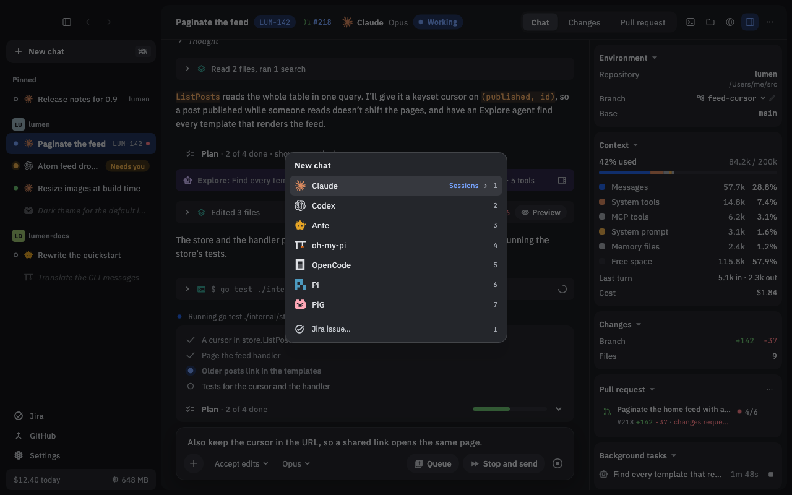

# Getting started

Nushi is a Mac and Linux app for coding agents. It runs the agents you already use as chats in one window. Each chat sits next to the agent's changes, your pull requests and a terminal. You can keep several chats going at once.

## Install Nushi

**On a Mac** (Apple silicon, macOS 13 or later), either:

- install it with Homebrew: `brew install --cask afrase/tap/nushi`, or
- download `Nushi-X.Y.Z.zip` from the [Releases page](https://github.com/afrase/nushi/releases), unzip it, and move **Nushi.app** to Applications. macOS blocks it the first time you open it. To allow it, go to **System Settings › Privacy & Security** and click **Open Anyway**.

**On Linux** (x86_64 or arm64), download `nushi-X.Y.Z-linux-amd64.tar.gz` (or `-arm64`) from the same [Releases page](https://github.com/afrase/nushi/releases), then run:

```sh
tar -xzf nushi-X.Y.Z-linux-amd64.tar.gz
nushi/install.sh
```

It installs into your home folder and doesn't need root. Open Nushi from your applications menu.

## Try a beta version

A beta is a version you can try before it's released. To switch to betas with Homebrew on a Mac, run:

```sh
brew uninstall --cask nushi && brew install --cask afrase/tap/nushi@beta
```

Your chats and settings stay. From then on, Nushi tells you about each new beta the same way it tells you about an update.

To go back to releases only:

```sh
brew uninstall --cask nushi@beta && brew install --cask afrase/tap/nushi
```

Without Homebrew, or on Linux, download a beta from the [Releases page](https://github.com/afrase/nushi/releases) and install it the same way you installed Nushi. It tells you about newer betas too.

## Update Nushi

When a new version is out, a small card appears in the bottom right corner of the window (above the message box, if one is there).

1. Click **Update**. The card says "Updating to Nushi…" while Homebrew downloads and installs it.
2. Nushi closes and opens again as the new version. Your chats keep running.

If the card shows an error instead, click **Retry**. A new release can take a few minutes to reach Homebrew. To run the update in a terminal instead, click **Copy**. It copies the Homebrew command.

If macOS asks whether Nushi Daemon may update other apps, allow it. If the card says the new version is installed, quit Nushi and open it again.

After an update, the daemon (what runs your chats) moves to the new version by itself once no chat is working. Meanwhile a bar says **Nushi will update its daemon when the chats are idle**, with **Restart now**. If the daemon is much older than the app, the window shows only **The daemon is older than this app** until it has moved over. Wait for your chats to finish, or click **Restart daemon**. Restarting stops running turns and closes terminals.

You see **Update** only if you installed Nushi with Homebrew. Otherwise the card has **Download**. It opens the release's page. Install the new version the same way you installed Nushi.

## What you need

You need a coding agent that you already use in the terminal, installed and signed in. Nushi works with Claude, Codex, Ante, oh-my-pi, OpenCode, Pi and PiG.

Nushi runs your own copy of the agent, with your login, settings and history.

## Check that Nushi sees your agent

1. Open **Settings** (⌘, or **Settings** at the bottom of the sidebar).
2. Click **Agents**.
3. Find your agent. **Ready** means you're set.

If it says **Not installed**, Nushi couldn't find the command. Check that it runs in a new terminal window, then come back and click **Reload** (under **Shell environment** at the bottom). If it says **Not signed in**, sign in to the agent in a terminal.

Codex can also sign in from Nushi. If it isn't signed in when a chat starts, you see **Codex isn't signed in**:

1. Click **Sign in with ChatGPT**. Your browser opens.
2. Sign in there. Nushi shows **Waiting for you to finish in the browser…** meanwhile; **Cancel** stops it.
3. Once you're done, the chat starts on its own.

Codex needs one extra piece: click **Set up** next to it. That needs Node and npm. (Or try **Run Codex without Node**, under Codex in the same page: it needs no Node and no Set up. It's new, so it's off unless you turn it on.)

## Your first chat

### 1. Start a chat

Click **New chat** at the top of the sidebar, or press ⌘N. A list of your agents opens. The one you used last is already picked. Click an agent, or press Enter.



### 2. Pick a folder

The agent works in a folder, usually your project. A chat from **New chat** starts with **No folder**. To work in your project, pick its folder before your first message:

1. Under the message box, click the folder name (**No folder**).
2. Pick a recent folder, or **Choose folder…**.

In a git repository you also see a **New worktree** chip. A worktree is a separate copy of the repository on its own branch. Turn the chip on and the chat works there, so your own checkout stays untouched.

You can also start a chat right in a folder:

- When no chat is open, click **Open a folder…** or one of the **Recent folders**.
- Hover a project in the sidebar and click its **+** (**New chat here**).

### 3. Send a message

Type in the box at the bottom and press ⏎. ⇧⏎ starts a new line.

Each step the agent takes, like reading a file or running a command, shows as a row. Click a row to open it. The agent's own pickers, such as its model and mode, sit under the box.

### 4. Answer a permission prompt

Some actions, like editing a file or running a command, need your OK. The agent stops and asks. A **Permission** card shows what it wants to do, with the agent's own choices as buttons (for example, allow once, allow always, or reject).

Click one. The card shrinks to a line saying what you answered, and the agent carries on.

The prompts come from the agent, and Nushi never answers them for you. To be asked less or more often, change the agent's mode under the box.

### 5. Stop the agent

Click the stop button (a square in a circle) at the right of the message box, or press Esc. If the agent hadn't answered yet, your message goes back into the box so you can change it.

You can still type while the agent works. ⏎ queues your message until the agent is done. ⌘⏎ stops the agent and sends your message now.

## Good to know

- On Linux, press Ctrl wherever this guide says ⌘.
- Nushi runs your agents in a background helper (the daemon). It keeps running after you quit the app, so a long task keeps going.
- A chat is the agent's own session. You can resume it in a terminal with the agent's usual resume command. It works the other way too: to open a session you started in a terminal, pick an agent in the **New chat** list and click **Sessions** (or press →).
- Agents get the same environment as a new terminal. After you change your shell's setup, click **Reload** in **Settings › Agents**.
- Some folders bring code that runs when an agent starts there, such as hooks, MCP servers (programs that give the agent extra tools) or extensions. Nushi lists that code on a trust card first. Click **Start anyway** only if you trust it.
- Pi and PiG have no permission prompts. Their tools run without asking.

## If Nushi can't read one of its files

Nushi keeps your settings, drafts, review comments and comment drafts in files in its data folder (`~/Library/Application Support/Nushi`, on Linux `~/.local/share/nushi`). If one of them can't be read when Nushi starts, a red notice at the top of the window says so, once, and nothing in the file is lost.

- **Nushi couldn't read its settings file, so settings are back to their defaults. The old file is kept as app.json.unreadable-…**: the file was damaged (cut short, or edited by hand). Nushi moved it aside and started fresh. The same for drafts (`drafts.json`), review comments (`reviews.json`) and comment drafts (`comment_drafts.json`). If only some review comments or comment drafts couldn't be read, the notice says some are missing, and a copy of the whole file is kept beside it.
- **Nushi can't read its settings file, so changes to settings won't be saved until it can.**: the file is there but couldn't be opened (its permissions, a disk error). Nushi leaves it as it is, keeps your changes while it runs, and saves them once it can read the file again.

To get something back from a kept copy, open it in a text editor. Delete it when you no longer need it. Close a notice with its ×.

## Where to go next

- [Chats](Chats): the window, the sidebar, keys and the command palette.
- [Reviewing changes](Reviewing-changes): see the agent's diff and leave comments for it.
- [Previews and terminals](Previews-and-terminals): files the agent writes, and shells under each chat.
- [GitHub](GitHub) and [Jira](Jira): pull requests and issues inside Nushi.
- [Phone](Phone): follow chats and answer prompts from your phone.
- [Skills and MCP servers](Skills-and-MCP-servers): give your agents more tools.
