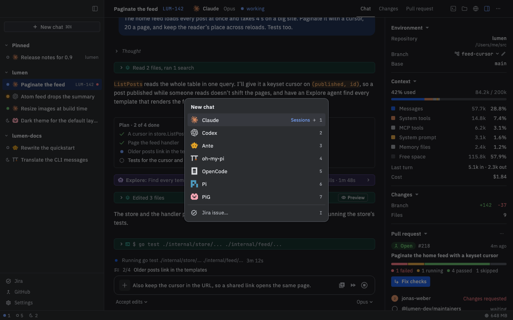

# Getting started

Nushi is a Mac and Linux app that runs the coding agents you already use as chats in one window. You see the conversation next to the agent's changes, your pull requests and a terminal, and you can keep several chats going at once.

## Install Nushi

**On a Mac** (Apple silicon, macOS 13 or later), either:

- install it with Homebrew: `brew install --cask afrase/tap/nushi`, or
- download `Nushi-X.Y.Z.zip` from the [Releases page](https://github.com/afrase/nushi/releases), unzip it, and move **Nushi.app** to Applications. The first time you open it, macOS refuses. Go to **System Settings › Privacy & Security** and click **Open Anyway**.

**On Linux** (x86_64 or arm64), download `nushi-X.Y.Z-linux-amd64.tar.gz` (or `-arm64`) from the same [Releases page](https://github.com/afrase/nushi/releases), then run:

```sh
tar -xzf nushi-X.Y.Z-linux-amd64.tar.gz
nushi/install.sh
```

It installs into your home folder, no root needed. Open Nushi from your applications menu.

## What you need

A coding agent you already use in the terminal, installed and signed in. Nushi works with Claude, Codex, Ante, oh-my-pi, OpenCode, Pi and PiG.

Nushi runs your own copy, with your login, settings and history.

## Check that Nushi sees your agent

1. Open **Settings** (⌘, or **Settings** at the bottom of the sidebar).
2. Click **Agents**.
3. Find your agent. **Ready** means you're set.

If it says **Not installed**, Nushi couldn't find the command. Check that it runs in a new terminal window, then come back and click **Reload** (under **Shell environment** at the bottom). If it says **Not signed in**, sign in to the agent in a terminal.

Codex needs one extra piece: click **Set up** next to it. That needs Node and npm.

## Your first chat

### 1. Start a chat

Click **New chat** at the top of the sidebar, or press ⌘N. A list of your agents opens, with the one you used last already picked. Click an agent, or press Enter.



### 2. Pick a folder

The agent works in a folder, usually your project. A chat from **New chat** starts in **No folder**. To work in your project, pick it before your first message:

1. Under the message box, click the folder name (**No folder**).
2. Pick a recent folder, or **Choose folder…**.

In a git repository you'll also see a **New worktree** chip. Turn it on and the chat works on its own branch, in a separate copy of the repository, so your checkout stays untouched.

Other ways in: on an empty window, **Open a folder…** and the **Recent folders** start a chat right in that folder. Later, hover a project in the sidebar and click its **+** (**New chat here**).

### 3. Send a message

Type in the box at the bottom and press ⏎. ⇧⏎ starts a new line.

Each step the agent takes, like reading a file or running a command, shows as a row you can click to open. The agent's own pickers, such as its model and mode, sit under the box.

### 4. Answer a permission prompt

When the agent wants to do something it needs your OK for, like editing a file or running a command, it stops and asks. A **Permission** card appears with what it wants to do and the agent's own choices as buttons (for example, allow once, allow always, or reject).

Click one. The card shrinks to a line saying what you answered, and the agent carries on.

The prompts are the agent's own, and Nushi never answers them for you. To be asked less or more, change the agent's mode under the box.

### 5. Stop the agent

Click the stop button (a square in a circle) at the right of the message box, or press Esc. If the agent hadn't answered yet, your message goes back into the box so you can change it.

While the agent works you can still type: ⏎ queues your message for when it's done, and ⌘⏎ stops it and sends yours now.

## Good to know

- On Linux, press Ctrl wherever this guide says ⌘.
- Nushi runs your agents in a background helper (the daemon). It keeps running after you quit the app, so a long task keeps going.
- A chat is the agent's own session, so you can resume it in a terminal with the agent's usual resume command. The other way works too: pick an agent in the **New chat** list and click **Sessions** (or press →) to open a session you started in a terminal.
- Agents get the same environment as a new terminal. After you change your shell's setup, click **Reload** in **Settings › Agents**.
- Before an agent starts in a folder that brings code of its own (hooks, MCP servers, extensions), Nushi lists that code on a trust card. Click **Start anyway** only if you trust it.
- Pi and PiG have no permission prompts: their tools run without asking.

## Where to go next

- [Chats](Chats): the window, the sidebar, keys and the command palette.
- [Reviewing changes](Reviewing-changes): see the agent's diff and leave comments for it.
- [Previews and terminals](Previews-and-terminals): files the agent writes, and shells under each chat.
- [GitHub](GitHub) and [Jira](Jira): pull requests and issues inside Nushi.
- [Phone](Phone): follow chats and answer prompts from your phone.
- [Skills and MCP servers](Skills-and-MCP-servers): give your agents more tools.
