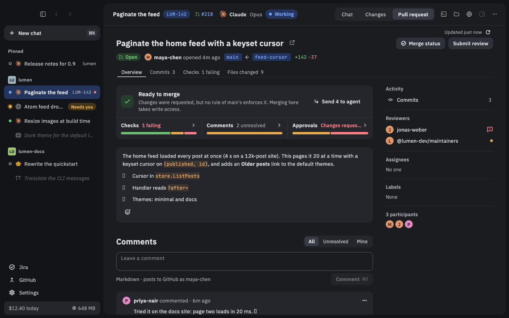

# GitHub

Nushi shows your pull requests next to the chats working on them. You can read checks, reviews and comments, hand them to the agent, and merge, all without a browser.

On Linux, use Ctrl wherever this page says ⌘.

## Connect GitHub

If you already use the `gh` command-line tool and are signed in (`gh auth login`), you're done. Nushi uses the same login.

To check, or to use a token instead:

1. Open **Settings › GitHub**. Under **Accounts** you see who you're signed in as, **Signed in** once GitHub has answered, and under it what's left of this hour's requests. The **⋯** beside it shows the token's kind and scopes.
2. To add a token, click **Add a token**, fill in **Host** (for example `github.com`) and **Token**, then click **Add**. Links to that host get chips right away, without restarting Nushi.

A classic token with the `repo` and `read:org` scopes covers everything. Nushi keeps it in your system keychain and sends it only to its own host. **Remove token…** in the **⋯** deletes it from there. If the keychain won't let it (a dismissed prompt, no keyring), the token is still removed from Nushi (the host goes back to your `gh` login, if you have one), and the token stays as "Nushi GitHub" for you to delete there.

## See your pull requests

Press **⌘G**, choose **View › GitHub**, or click **GitHub** at the bottom of the sidebar. You get an inbox with three lists:

- **Review requested**: pull requests waiting on your review. Switch between **Only me** and **Me and my teams**.
- **My pull requests**
- **Assigned issues**

To see a row's details, click it (or press ⏎). Press Esc to go back.

## Start work on a pull request or issue

1. In the inbox, hover over a row and click **Start work** (or select it and press ⌘⏎).
2. Pick a folder. Clones of that repository are listed first.
3. The **New chat** dialog opens. Pick an agent and start.

For a pull request, the chat works on its branch, so the agent's pushes go to that pull request. For an issue, Nushi makes a branch named after it.

## Links in a chat

A pull request or issue link in a message, yours or the agent's, shows as a chip: its state's icon, `owner/repo#123` and its title. Hold the pointer over the chip to see its state, author, age and size.

- Click a chip to open it on GitHub.
- Right-click it for **Copy link**, **Show in GitHub view** and, for a pull request, **Link to this chat**.

A link written as words stays as words, with the same card on hover. Links in code and in tool output stay as written. A link to a host Nushi has no token for stays a plain link.

## Open a pull request from a chat

To open a pull request, ask the agent ("push this and open a PR"). Nushi has no button for it. When the agent's `gh pr create` finishes:

- The chat links the new pull request.
- A card for it shows in the chat, with its state, title, size and checks. Click the card to open the tab.
- A **Pull request** tab appears.

A merge the agent runs gets the same card. The card is only there while you stay on the chat.

Once the chat pushes its branch, it also finds that branch's pull request by itself. This works only for a pull request opened while the chat existed: not before the chat started, and not after you archived it. A new chat on a branch that already has a pull request doesn't take it, and an archived chat takes nothing new. To add a pull request you opened from your own terminal, use **Link pull request…**. The branch's pull request is first in the list.

A chat can hold up to 10 pull requests, such as a stack the agent opened branch by branch. To add one by hand, use **Link another pull request…** in the **Pull requests** widget's ⋯ (or **Chat › Link Pull Request…**). Then paste its link, `owner/repo#123` or number.

## The Pull requests widget

The details panel lists the chat's pull requests, a row each: its state's icon, title, checks (`8/11`) and one thing to know, such as **2 threads** or **Ready to merge**. A stack lists its base first.

- Click a row to open its **Pull request** tab.
- Click the checks to see them, or **Fix checks** to send the failures to the agent.
- Use a row's **⋯** for **Merge…**, **Send open threads to agent**, **Clean up…** or **Unlink**.

The chip next to the chat's title shows the first pull request, and `+2` for the others. Hold the pointer over it to see them all. When the chat has several, the tab has a menu at the top to pick which one it shows.

## The Pull request tab

The tab looks like the pull request's page on GitHub, so what you know from there works here. Click **Pull request** next to **Chat** and **Changes** at the top of the chat, or press ⌃⌘3 (Ctrl+Alt+3 on Linux).

- **Merge status** and **Submit review** are at the right of the title. Scroll down and a slim bar at the top keeps the state, number, title and both buttons in view.
- **Four tabs**: **Overview**, **Commits**, **Checks** (every check, with **Re-run failed**) and **Files changed** (the diff, with review threads at their lines).
- **Overview** starts with the **merge status card**: whether it can merge and what blocks it, the merge button, and three segments, **Checks**, **Comments** and **Approvals**. Click a segment to see its list.
- Under the card are the description, the **Comments** (filter them by **All**, **Unresolved** or **Mine**; the box to write one comes first, then the newest), and the latest commits. Reviewers, assignees and labels are at the right.

## Send review feedback to the agent

1. Do one of these:
   - In the merge status card, click **Send N to agent** to send everything that blocks the merge.
   - Open the **Checks** segment and click **Send to agent** on a failing check.
   - Click **Send to agent** under a review thread, or in a comment's **⋯**.
2. Each item goes into the chat's message box as a card, quoting the comment or the failing log.
3. Add anything you want to say, and send.

**Fix checks** in the **Checks** tab sends every failed check at once.

## When checks fail

When a chat's pull request fails its checks after the agent is done, the chat shows **Needs you** (an amber dot, counted on the Dock's badge). A bar over the message box says **Checks failed on #n**. Nushi never fixes or sends anything by itself.

1. Click **Ask to fix**. Each failed check goes into the message box as a card with the failing part of its log.
2. Add anything you want to say, and send.

Click **✕** instead to dismiss it. The same failure doesn't ask again, but a failure after a new push does. A failure that was already there when Nushi first saw the chat doesn't ask.

By default, review cards tell the agent not to reply on GitHub, and failed-check cards tell it not to commit or push. Change what each kind of card asks in **Settings › GitHub › What reply cards ask**:

1. Click **Edit** beside the kind of card.
2. Change the words and click **Save**. Empty asks the default.
3. A changed kind says **Edited**. Click **Reset** beside it to go back to the default.

## React to a comment

Reactions show under the description and each comment, as on GitHub: an emoji and how many people used it. Yours are filled in blue with a ring.

1. Click the smiley under the comment.
2. Pick one of the eight emoji. It's added on GitHub.

Click one of your reactions to take it back, or someone else's to add yours.

## Mark files viewed

As on GitHub, you can tick off each file once you've looked at it. Nushi saves the mark on GitHub, so github.com shows it too.

1. Open **Files changed** and pick a file.
2. Click **Viewed** at the right of the file's name. The file folds, and gets a green tick in the list.
3. To look again, click the chevron before its name. Click **Viewed** again to untick it.

The top of the list counts them, such as **1 / 4 files viewed**. A file that changed after you marked it says **Changed since last view** and is unticked again.

## Reply, review and resolve

- In a thread, click **Reply…**, **Resolve conversation** or **Unresolve conversation**. Resolved and outdated threads are folded: click **Show**.
- To write an inline comment in **Files**, hover over a line and click the blue **+**, or click or drag across line numbers.
- Click **Submit review** at the right of the title to send your review: **Comment**, **Approve** or **Request changes**, then **Submit review**.

## Edit the title or description

You can change a pull request's title and description here, if GitHub lets you (you opened it, or you can write to the repository).

1. Click the pencil (**Edit**) beside the title, or at the top right of the description.
2. Change the text. The description is Markdown.
3. Click **Save** (or press Enter for the title, ⌘Enter for the description). **Cancel** or Esc leaves it as it was.

If someone changed it on GitHub while you were editing, Nushi doesn't save over it and keeps your text. Click **Show GitHub's version** to see theirs, then **Save** to replace it with yours, or **Cancel**.

## Merge

When the pull request can merge, the merge status card says **Ready to merge**. If it can't, it says why (failing checks, a review needed, conflicts, and so on).

1. Pick a method from the merge button's ▾: **Create a merge commit**, **Squash and merge** or **Rebase and merge**. Nushi remembers your choice for each repository.
2. Click the button. A dialog shows what will merge. For a merge commit or a squash, you can edit the commit message.
3. Confirm with the dialog's button, named for the method. Merging can't be undone.

If the repository allows it, **Enable auto-merge** lets GitHub merge the pull request by itself once it's ready. If the base branch uses a merge queue, you see **Add to queue** or **Merge when ready** instead.

After the merge, **Clean up…** offers to delete the worktree and branches and to archive the chat. If another of the chat's pull requests is still open on its branch, Clean up deletes only the merged one's branch on GitHub. It tells you which pull request keeps the rest.

## Good to know

- Nushi always follows your repository's merge rules.
- A chat's row in the sidebar gets a red dot while its checks fail, and an amber one while they run.
- For a pull request from a fork, the chat's branch isn't linked to the fork, so a push from the chat doesn't reach the pull request.
- A fine-grained token works, but sees only one owner's repositories and can't show checks.
- While Nushi runs it checks your chats' pull requests' state once a minute, every 5 minutes while its window is in the background. It reads a whole pull request only while the GitHub view or its Pull request tab shows it, and only writes what you send.
- Text you're writing in a reply or review stays if you switch to another chat. It's lost if you quit Nushi.
- The [Phone](Phone) shows a one-line pull request summary in the chat (`+2` for the others) and the link chips, but has no Pull request tab.
