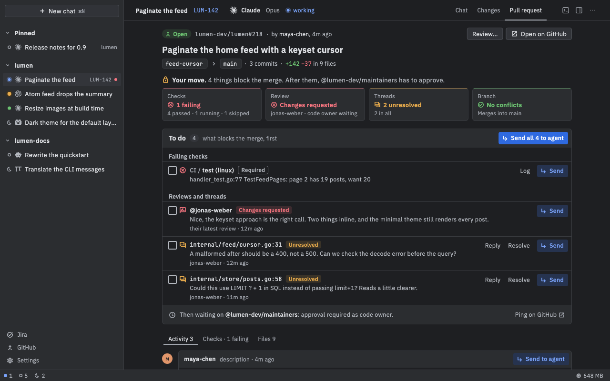

# GitHub

Nushi shows your pull requests next to the chats working on them. Read checks, reviews and comments, hand them to the agent, and merge, without a browser.

On Linux, use Ctrl wherever this page says ⌘.

## Connect GitHub

If you already use the `gh` command-line tool and are signed in (`gh auth login`), you're done. Nushi uses the same login.

To check, or to use a token instead:

1. Open **Settings › GitHub**. Under **Hosts** you see who you're signed in as.
2. To add a token, click **Add a token**, fill in **Host** (for example `github.com`) and **Token**, then click **Add**.

A classic token with the `repo` and `read:org` scopes covers everything. Nushi keeps it in your system keychain and sends it only to its own host.

## See your pull requests

Press **⌘G**, choose **View › GitHub**, or click **GitHub** at the bottom of the sidebar. You get an inbox with three lists:

- **Review requested**: pull requests waiting on your review. Switch between **Only me** and **Me and my teams**.
- **My pull requests**
- **Assigned issues**

Click a row (or press ⏎) to see its details. Press Esc to go back.

## Start work on a pull request or issue

1. In the inbox, hover a row and click **Start work** (or select it and press ⌘⏎).
2. Pick a folder. Clones of that repository are listed first.
3. The **New chat** dialog opens. Pick an agent and start.

For a pull request, the chat works on its branch, so the agent's pushes go to that pull request. For an issue, Nushi makes a branch named after it.

## Links in a chat

A pull request or issue link in a message, yours or the agent's, shows as a chip: its state's icon, `owner/repo#123` and its title. Hold the pointer on it to see its state, author, age and size.

- Click a chip to open it on GitHub.
- Right-click it for **Copy link**, **Show in GitHub view** and, for a pull request, **Link to this chat**.

A link with words of its own stays words, with the same card. Links in code and in tool output stay as written, and a link to a host Nushi has no token for stays a plain link.

## Open a pull request from a chat

There's no "create pull request" button. Ask the agent ("push this and open a PR"). A few seconds later the chat finds the pull request for its branch, and a **Pull request** tab appears.

If it finds the wrong one, use **Chat › Link Pull Request…** to link one by its link, `owner/repo#123` or number.

## The Pull request tab

Click **Pull request** next to **Chat** and **Changes** at the top of the chat, or press ⌃⌘3 (Ctrl+Alt+3 on Linux). From top to bottom:

- **The header** says whose move it is, such as "Your move.", "Waiting on checks." or "Ready to merge."
- **Four status lights**: **Checks**, **Review**, **Threads** and **Branch** (conflicts, or behind its base). Click one to jump to the details.
- **To do**: everything blocking the merge. Each failing check (**Log** shows the failing part), each open review thread (**Reply**, **Resolve**), and findings that review bots list.
- Three tabs, each with a count: **Activity** (the conversation), **Checks** (every check, with **Re-run failed**) and **Files** (the diff, with review threads at their lines).

## Send review feedback to the agent

1. In **To do**, click **Send** on one item, or tick a few and click **Send N picked**, or click **Send all N to agent**.
2. Each item lands in the chat's message box as a card, quoting the comment or the failing log.
3. Add anything you want to say, and send.

Comments and threads elsewhere in the tab have **Send to agent**, and **Fix checks** sends every failed check at once.

By default, review cards tell the agent not to reply on GitHub, and failed-check cards tell it not to commit or push. Change what each kind of card asks in **Settings › GitHub › What reply cards ask**.

## Reply, review and resolve

- In a thread, use **Reply**, **Resolve** or **Unresolve**.
- In **Files**, select lines to write an inline comment.
- Click **Review…** to send your review: **Comment**, **Approve** or **Request changes**, then **Submit review**.

## Merge

When the pull request can merge, the merge box says **Ready to merge**. If it can't, it says exactly why (failing checks, a review needed, conflicts, and so on).

1. Pick a method from the merge button's ▾: **Create a merge commit**, **Squash and merge** or **Rebase and merge**. Nushi remembers your choice for each repository.
2. Click the button. A dialog shows what will merge. For a merge commit or a squash, you can edit the commit message.
3. Confirm with the dialog's button, named for the method. Merging can't be undone.

If the repository allows it, **Enable auto-merge** lets GitHub merge it by itself once it's ready. If the base branch uses a merge queue, you'll see **Add to queue** or **Merge when ready** instead.

After the merge, **Clean up…** offers to delete the worktree and branches and archive the chat.

## Good to know

- Nushi never gets around your repository's merge rules.
- A chat's row in the sidebar gets a red dot while its checks fail, and an amber one while they run.
- For a pull request from a fork, the chat's branch isn't linked to the fork, so a push doesn't reach the pull request.
- A fine-grained token works, but sees only one owner's repositories and can't show checks.
- Nushi only checks GitHub while the GitHub view or a chat with a pull request is open, and only writes what you send.
- Text you're writing in a reply or review waits for you if you switch to another chat, but is lost if you quit Nushi.
- The [Phone](Phone) shows a one-line pull request summary in the chat, but has no Pull request tab.
