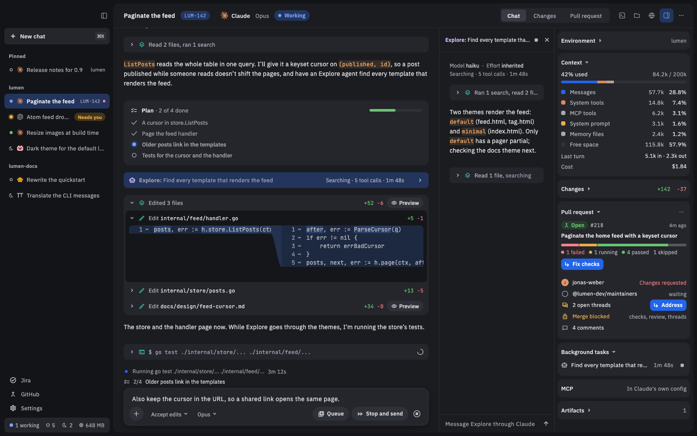

# Nushi

Nushi is a Mac and Linux app for working with coding agents. It runs the agents you already use (Claude, Codex, Ante, oh-my-pi, OpenCode, Pi and PiG) as chats in one window, next to their changes, your pull requests and a terminal.

## Start here

[Getting started](Getting-started): install Nushi and run your first chat. About five minutes.

## Then, as you need them

- [Chats](Chats): sending, stopping, answering the agent, finding old chats.
- [Reviewing changes](Reviewing-changes): see what the agent changed and comment on it.
- [Previews and terminals](Previews-and-terminals): files the agent writes, and shells beside each chat.
- [GitHub](GitHub): pull requests, checks and reviews, and handing them to the agent.
- [Jira](Jira): your issues and sprints, and starting work on one.
- [Phone](Phone): keep an agent going from your phone.
- [Skills and MCP servers](Skills-and-MCP-servers): what your agents can use, and which agents Nushi found.

Something wrong or missing? [Open an issue](https://github.com/afrase/nushi/issues).
