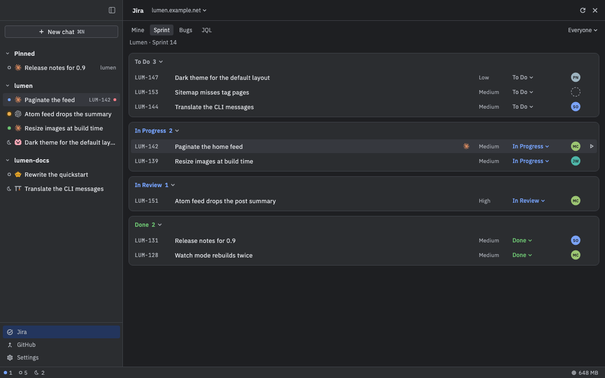

# Jira

Nushi shows your Jira Cloud issues next to your chats. See what's on your plate, move an issue along, and start an agent on one, on its own branch, in a couple of clicks.

## Connect your Jira site

You need three things:

- your site's address, such as `example.atlassian.net`;
- the email you sign in to Jira with;
- an API token (classic or scoped).

Make the token on Atlassian's site: click **Make a token** in Nushi's form, or go to [id.atlassian.com/manage-profile/security/api-tokens](https://id.atlassian.com/manage-profile/security/api-tokens). Paste it only into that form, never into a chat.

1. Open **Settings** (at the bottom of the sidebar, or ⌘,) and pick **Jira**.
2. The **Add a Jira Cloud site** form opens. If you already have a site, click **Add a site** first.
3. Fill in **Site**, **Email** and **API token**. **Expires** is optional: give the token's end date to get a warning before it runs out.
4. Click **Add**.

Nushi checks the token with Jira, then the site's row says **Connected as** and your name. **Remove** disconnects a site.

## Open your issues

Press ⌘J, or click **Jira** at the bottom of the sidebar (also **View › Jira**). Jira takes the chat's place. Press Esc or click the close button to go back to your chats.

The tabs at the top pick which issues you see:

- **Mine**: your open issues.
- **Sprint**: the active sprint of a board. The first time, click **Pick the board…** and choose one.
- **JQL**: type a Jira search. It suggests fields, operators and values as you type. Press Return to run it, then **Save…** to keep it as a tab of its own.

Issues are grouped into a card per status. Click a card's title to fold it, or drag it to reorder. Nushi remembers both.

On **Sprint**, **JQL** and saved searches, the menu at the right (**Everyone**) narrows the list to **Me**, **Unassigned**, or one person.

If you have more than one site, the menu next to the **Jira** title switches sites. **All sites** shows your open issues from every site at once.

## Start work on an issue

This starts an agent on the issue in a worktree: a second checkout of your repository on its own branch, so the agent's work doesn't touch the branch you have open.

1. Hover over the issue's row and click the play button at its end (or select the row and press ⌘⏎, or right-click it and pick **Start work**).
2. Pick a recent folder from the menu, or **Choose folder…** to pick your repository.
3. The **New chat** dialog opens with the issue already picked. It says **In a new worktree on** and shows the branch name, made from the issue's key and summary (for example `PROJ-123-fix-the-login`).
4. Pick an agent and press Return.

Before step 4, press **W** to skip the worktree and work in the folder itself, **B** to rename the branch, or ⌫ to drop the issue.

The chat shows the issue's key in the sidebar. Nushi tells the agent which issue it's on, but writes nothing into your message: tell the agent what you want, as usual.

You can also attach an issue from the **New chat** dialog itself: press **I**, then paste the issue's link, type its key, or search by words.

## Look at an issue

Click a row to see the issue's details: description, subtasks, links, attachments, comments, and the chats already started on it. You can comment (Markdown works), click **Start work**, or open the issue in your browser. Press Esc to return to the list.

## Move an issue

Click an issue's status, on its row or in its details, and pick a move. Only the moves Jira allows are listed. If a move needs more fields, Nushi asks for them.

## Keys

| Key | What it does |
| --- | --- |
| ⌘J | Open or close Jira |
| ↑ ↓ or j k | Select an issue |
| Return | Show its details |
| ⌘⏎ | Start work on it |
| ⌘R | Refresh |
| / | Jump to the JQL search |
| ⌥⌘1–9 | Switch to the first to ninth tab |
| Esc | Back to the list, then close |

On Linux, use Ctrl wherever the Mac uses ⌘. The one exception: ⌥⌘1–9 is Alt+1–9.

## Good to know

- Your token is kept in your Mac's keychain (the keyring on Linux), never in a file. **Remove** deletes it from there.
- If Nushi says it needs your OK to read the token (after an update, say), click **Allow…** and enter your password when asked. If it offers **Restart daemon** instead, click that; it stops running turns and closes terminals.
- The list refreshes every minute while it's open, showing the last results while new ones load.
- A chat started on an issue gives the agent tools for that one issue: read it, comment on it, and move it. The agent's own permission mode decides whether it asks you first. The issue's details show which comments and moves came from an agent.
- If you gave an expiry date, Nushi warns you two weeks before the token runs out. Make a new token and add the site again.
