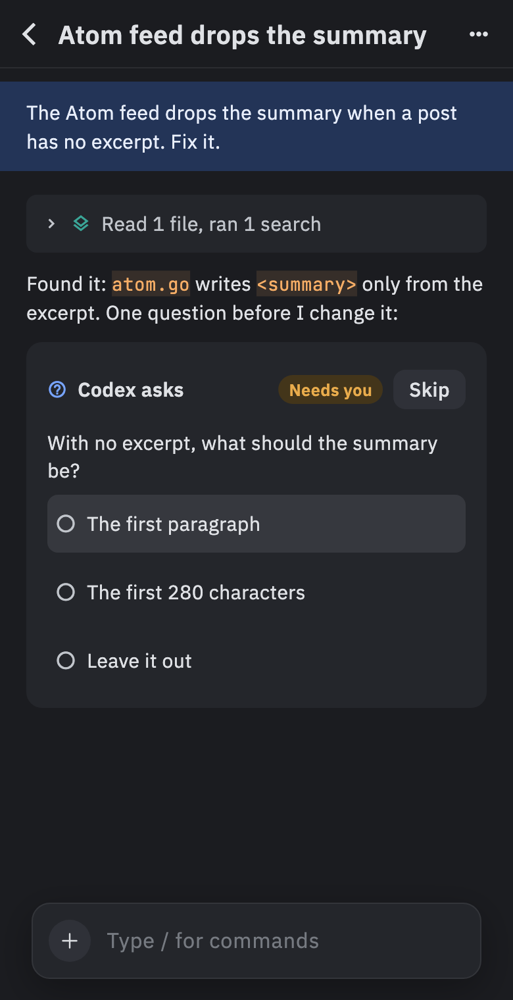

# Phone

The phone app keeps an agent going while you're away from your desk. From your phone you can follow your chats, answer the agent's questions and permission prompts, and send it a message. It's made for checking in. Big diffs are easier to read on your computer.

## What you need first

The phone reaches your computer through a **relay**: a small server program that passes messages between the two. The messages are end-to-end encrypted, so the relay can't read them. It keeps nothing.

Nushi doesn't run a relay for you. You or your team run one on a server that your phone and your computer can both reach, with an address like `wss://relay.example.com`. The same server also hosts the phone app. To set one up, see the [relay setup guide](https://github.com/afrase/nushi/blob/main/docs/remote.md#the-relay). To update it, run `sudo nushi-relay -update -restart-unit nushi-relay` on the server ([details](https://github.com/afrase/nushi/blob/main/docs/remote.md#updating-a-relay-from-a-release)).

## Turn on remote access

1. Open **Settings › Remote access** in Nushi on your computer.
2. Type your relay's address (`wss://…`) in the box.
3. Turn on the **Remote access** switch.

The line under the box should say **Connected**. While remote access is on, Nushi stops your computer from going to sleep on its own, so the phone can reach it.

## Add Nushi to your phone

The phone app is a web app that you add to your Home Screen. On an iPhone with iOS 16.4 or later:

1. Open your relay's address in Safari, as `https://relay.example.com/`.
2. Tap **Share**, then **Add to Home Screen**.
3. Open Nushi from the Home Screen.

Always pair and use Nushi from the Home Screen icon. Don't use it in Safari. The Home Screen app keeps its own storage, and only it can show notifications.

## Pair your phone

1. On your computer: **Settings › Remote access › Pair a phone**. A QR code appears.
2. In Nushi on your phone, check the device name. Your computer lists the phone by this name.
3. Tap **Scan QR code**, allow the camera, and point it at the code.
4. Your phone shows a six-digit code. Your computer asks **Pair iPhone?** (with your device's name) and shows a code too.
5. If the two codes match, click **Allow** on your computer. If they don't, click **Deny**.

If you can't scan the code, click **Copy link** on your computer and send the link to your phone (with Universal Clipboard or AirDrop). Paste it into **Pairing link** on the phone and tap **Pair**.

Don't scan the code with the iPhone's own Camera app. That opens Safari, and pairing only works inside Nushi on the Home Screen.

## Turn on notifications

1. On your phone, tap **Settings** (the gear on the **Chats** screen).
2. Turn on **Notifications**, and tap **Allow** when iOS asks.

You get a notification when a chat finishes, when its turn fails, when the agent has a question, when it needs your permission, or when one of Claude's workflows finishes, fails or stops. It says only what happened, such as "Claude finished" or "Codex needs you". It never shows what's in the chat. Tap it to open that chat. You don't get one for the chat you have open.

To check notifications work, click **Send a test notification** next to your phone in **Settings › Remote access** on your computer.

## Follow your chats

The **Chats** screen lists your chats. Chats waiting on you come first, under **Needs you**. Then come your **Pinned** chats, then the rest by folder.

Tap a chat to see its transcript. When the agent asks a question or asks for permission, answer it with a tap.

A chat running one of Claude's workflows says **working**, and the workflow's card shows its phase, progress, tokens and time, as on the Mac. Tap the card to open it in place: what it does, then each phase with the subagents running in it, and the phases still **planned**. Tap it again to close it. To stop it, open the chat's **⋯** menu and tap **Stop Workflow: …**. If other tasks are running too, the item says **Stop N background tasks**.

## Send a message or stop the agent

The buttons beside the message box are icons. Press and hold one to see its name.

- **Send a message**: type in the box at the bottom and tap the return arrow (↵).
- **While the agent is working**: type your message, then pick one of two buttons. **Queue** (a stack of squares) sends it after the current turn ends. **Stop and send** (fast-forward, ⏩) stops the turn and sends your message right away.
- **Stop the agent**: tap **Stop** (a square in a circle).

To start a new chat, tap **+** on the **Chats** screen, pick a folder and an agent, and tap **Start**.

## Unpair a phone

- **On your phone**: **Settings › Forget this Mac** (on Linux it says **Forget this computer**). The phone forgets the pairing and its key.
- **On your computer**: click **Revoke** next to the phone in **Settings › Remote access**. Do this as well, or your computer keeps listing the phone.

If a phone is lost or stolen, revoke it on your computer right away. A paired phone can read your files and run commands on your computer as you.

## Good to know

- If your computer is asleep, offline, or has remote access turned off, the phone first shows **Reconnecting…** with a spinner. Then it shows **Can't reach your Mac** (or **computer**) and why. It keeps trying on its own. To retry now, tap **Try again**.
- When the phone app has a new version, it shows **Nushi was updated**. Tap **Reload**.
- If the Nushi daemon on your computer is much older than the phone app, the phone says **Open Nushi on your Mac to update its daemon** (or **computer**). The phone keeps working, and in a chat the bar steps aside while you type. Open Nushi on the computer, and if it offers an update, click **Update**: the app may be as old as the daemon, as when the relay was updated first. The daemon moves to the new version once no chat is working. Anything the old daemon can't do yet fails with the same words.
- If the browser won't open the phone app's storage, it shows **Couldn’t open this app’s storage**. Tap **Reload**. Don't pair again: that replaces this phone's key, and the pairing is likely still there.
- A chat's **⋯** menu shows its folder, branch, model and agent, with actions such as **Rename…**, **Files**, **Fork**, **Pin**, **Sleep** (or **Wake** for a sleeping chat, which starts its agent without sending anything) and **Archive**.
- A chat's pull request shows at the top of the chat, with `+2` when it has more. Tap it to open it on GitHub. If the chat has several, tapping lists them all. A pull request or issue link in a message is a chip. Tap it to see its state and title, then tap **Open on GitHub**.
- Files the agent wrote open full screen from **Artifacts** at the top of the chat. More on these in [Previews and terminals](Previews-and-terminals).
- The phone app also works in a desktop browser. Chrome on a Mac gets notifications too.
- Closing a laptop's lid can still put it to sleep, even with remote access on.
- If Nushi can't read the file that holds its remote access key or its paired phones, it starts remote access over with a new key, so every phone has to pair again. **Settings › Remote access** says so in red, with the old file's name (it's kept in the data folder, with `.unreadable-` and the time added), until you pair a phone. To pair again, follow [Pair your phone](#pair-your-phone).
