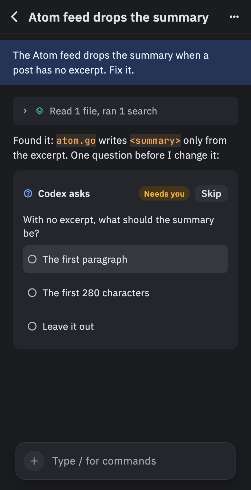

# Phone

The phone app lets you keep an agent going while you're away from your desk. You can follow your chats, answer the agent's questions and permission prompts, and send it a message, all from your phone. It's for checking in, not for reading big diffs.

## What you need first

The phone reaches your computer through a **relay**: a small server program that passes messages between the two. It can't read them, because they're end-to-end encrypted, and it keeps nothing.

Nushi doesn't run a relay for you. You or your team run one on a server that your phone and your computer can both reach, with an address like `wss://relay.example.com`. The same server also hosts the phone app. The [relay setup guide](https://github.com/afrase/nushi/blob/main/docs/remote.md#the-relay) covers this.

## Turn on remote access

1. Open **Settings › Remote access** in Nushi on your computer.
2. Type your relay's address (`wss://…`) in the box.
3. Turn on the **Remote access** switch.

The line under the box should say **Connected**. While remote access is on, Nushi stops your computer from going to sleep on its own, so the phone can reach it.

## Add Nushi to your phone

The phone app is a web app that you add to your Home Screen. On an iPhone (iOS 16.4 or later):

1. Open your relay's address in Safari, as `https://relay.example.com/`.
2. Tap **Share**, then **Add to Home Screen**.
3. Open Nushi from the Home Screen.

Always pair and use Nushi from the Home Screen icon, not from Safari. The Home Screen app keeps its own storage, and only it can show notifications.

## Pair your phone

1. On your computer: **Settings › Remote access › Pair a phone**. A QR code appears.
2. In Nushi on your phone, check the device name. Your computer lists the phone by this name.
3. Tap **Scan QR code**, allow the camera, and point it at the code.
4. Your phone shows a six-digit code. Your computer asks **Pair iPhone?** (with your device's name) and shows a code too.
5. If the two codes match, click **Allow** on your computer. If they don't, click **Deny**.

Can't scan? Click **Copy link** on your computer and get the link to your phone (Universal Clipboard or AirDrop). Paste it into **Pairing link** on the phone and tap **Pair**.

Don't scan the code with the iPhone's own Camera app. That opens Safari, and pairing only works inside Nushi on the Home Screen.

## Turn on notifications

1. On your phone, tap **Settings** (the gear on the **Chats** screen).
2. Turn on **Notifications**, and tap **Allow** when iOS asks.

You get a notification when a chat finishes, when its turn fails, when the agent has a question, or when it needs your permission. It says only what happened, such as "Claude finished" or "Codex needs you", never what's in the chat. Tap it to open that chat. You don't get one for the chat you have open.

To check notifications work, click **Send a test notification** next to your phone in **Settings › Remote access** on your computer.

## Follow your chats

The **Chats** screen lists your chats. Those waiting on you come first, under **Needs you**, then your **Pinned** chats, then the rest by folder.

Tap a chat to see its transcript. When the agent asks a question or asks for permission, answer it with a tap.

## Send a message or stop the agent

The buttons beside the message box are icons. Press and hold one to see its name.

- **Send a message**: type in the box at the bottom and tap the return arrow (↵).
- **While the agent is working**: type your message, then pick one of two buttons. **Queue** (a stack of squares) sends it after the current turn ends. **Stop and send** (fast-forward, ⏩) stops the turn and sends yours right away.
- **Stop the agent**: tap **Stop** (a square in a circle).

To start a new chat, tap **+** on the **Chats** screen, pick a folder and an agent, and tap **Start**.

## Unpair a phone

- **On your phone**: **Settings › Forget this Mac** (on Linux it says **Forget this computer**). The phone forgets the pairing and its key.
- **On your computer**: click **Revoke** next to the phone in **Settings › Remote access**. Do this too, or your computer keeps listing the phone.

If a phone is lost or stolen, revoke it on your computer right away. A paired phone can read your files and run commands on your computer as you.

## Good to know

- If your computer is asleep, offline, or has remote access turned off, the phone first shows **Reconnecting…** with a spinner, then **Can't reach your Mac** (or **computer**) and why. It keeps trying on its own. Tap **Try again** to retry now.
- When the phone app has a new version, it shows **Nushi was updated**. Tap **Reload**.
- A chat's **⋯** menu shows its folder, branch, model and agent, with actions such as **Rename…**, **Files**, **Fork**, **Pin**, **Sleep** and **Archive**.
- A chat's pull request shows at the top of the chat, with `+2` when it has more. Tap it to open it on GitHub, or, with several, to list them all. A pull request or issue link in a message is a chip: tap it to see its state and title, then **Open on GitHub**.
- Files the agent wrote open full screen from **Artifacts** at the top of the chat. More on these in [Previews and terminals](Previews-and-terminals).
- The phone app also works in a desktop browser. Chrome on a Mac gets notifications too.
- Closing a laptop's lid can still put it to sleep, even with remote access on.
