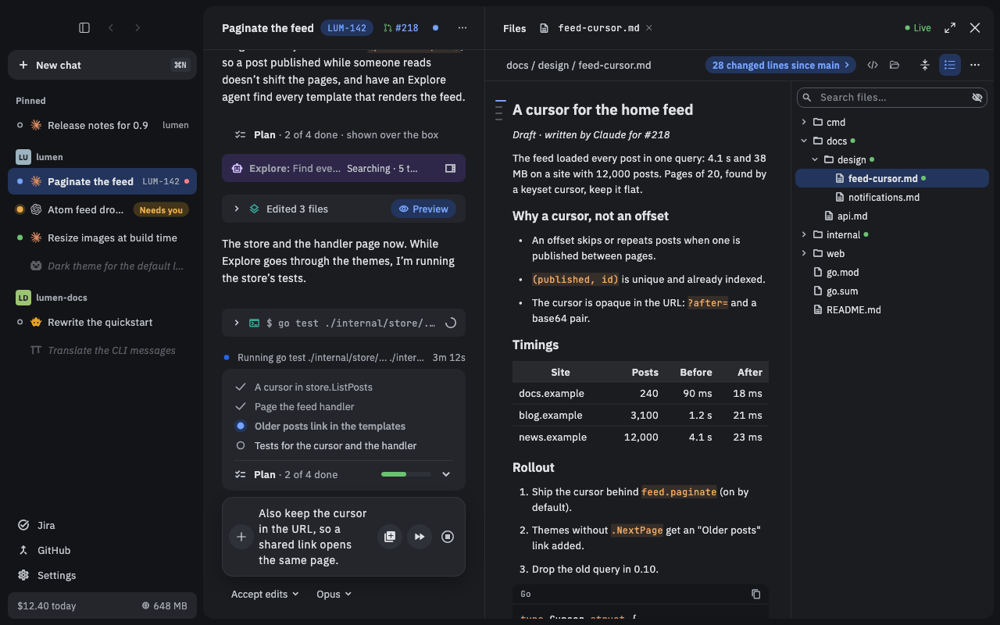
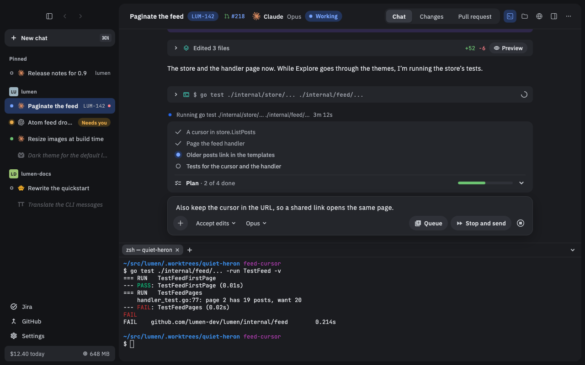

# Previews and terminals

When the agent writes a file, such as a report, a web page or a diagram, you can see it next to the chat. It updates as the agent changes it. Each chat can also have its own terminals, so you can run commands in the chat's folder without leaving Nushi.

Shortcuts below are the Mac's. On Linux, use Ctrl where the Mac uses ⌘, and Alt where it uses ⌥. Terminals use different keys on Linux; they're given where they come up.

## Open a file

When the agent writes a document, page, image or diagram, its row in the chat has a **Preview** button. Click it and the file opens in the **Files** pane. The pane sits beside the chat, to the right of the details panel, and runs from the top of the window to the bottom. In a narrow window it covers the chat's right side instead. Where the row is narrow (in a subagent's pane), the button is inside the row: click the row to open it first.

Other ways to open a file:

- **Artifacts**: in the details panel (the panel button in the chat's header), the **Artifacts** list shows the documents, pages and images the chat made. Click one to open it.
- **Open file** (⌘P): type part of a name to open any file in the chat's folder, code included.
- **Files** (⇧⌘E, or the folder button in the header): the open files on the left and a tree of the chat's folder on the right, as in Claude's desktop app. With nothing open it says **Open files appear here**. Files with changes have a dot (see below). Opening a file never moves the tree. To find a file anywhere in the folder, type in **Search files…** above the tree.

The three buttons at the right of the pane's second row do this:

- The first collapses every folder.
- The second hides or shows the tree (⇧⌘Y). When the tree is hidden, the open file takes its room.
- **⋯** has **Go to file or search** (⌘P), **File tree position** (the tree on the left or the right; Automatic keeps it at the window's edge) and **Preview tabs**. It also sets how a file's source shows: **Word wrap**, **Indent guides**, **Show whitespace**, **Scroll past end** and **Tab size** (2, 4 or 8 columns).

Some agents can also open a file in the Files pane themselves, or open a page from your own machine in the browser.

## What you can preview

- **Markdown**, rendered. Long documents get a small outline on the left; point at it to jump to a heading.
- **HTML pages and SVG**, shown as a web page. Use **Reload**, or **Open in browser** to view it in your normal browser.
- **Images** and **PDFs**.
- **CSV files**, as a table (the first 500 rows).
- **Mermaid diagrams** (`.mmd` or `.mermaid` files). Mermaid blocks in the agent's messages draw as diagrams too.
- **Code and text files**, with syntax highlighting.

In a Markdown preview, images written as HTML (``, a README's logo) and SVG images show as pictures. An SVG that would load anything from elsewhere or run anything shows as its text instead.

The file's path is above the file, in the pane's second row. Click the path to copy it.

## See which lines changed

A file's code shows which lines the chat changed, committed or not. You can see what the agent changed without opening a diff.

- For a chat on its own branch, the marks show the same changes as the **Changes** tab's **Branch** view, so they stay after the agent commits.
- For a chat working straight on the main branch, the marks count from before the chat's own commits (the commits made since the chat began). If the chat hasn't committed, they count from the last commit.

Beside the line numbers, a green bar marks added lines and a blue bar marks changed lines. A small red wedge marks where lines were removed. The marks follow what you type, too.

Next to the file's path, a pill says what the marks count from and how many lines changed: **5 changed lines since main**, **since this chat began** or **since the last commit**. A new file says **New file**, and every line has the green bar.

1. Point at a mark, or click it, to see what those lines were: **Before this branch**, **Before this chat**, or **Before** when it's the last commit.
2. Click elsewhere to close it.
3. For the full diff, right-click a file with a dot in the tree and pick **Show changes**: it opens in the chat's **Changes** tab.

Rendered views (Markdown, CSV, HTML) can't show marks: click the pill (**3 changed lines since main ›**) to switch to the source, where they are.

In the tree, a green dot marks every file with changes (the ones that open with marks or **New file**), whoever made them: the agent, a command, or you. Folders that hold such a file have the dot too, even when closed. A file the chat changed and then put back as it was has no dot. Opened, it says **No changes since main**. In a folder that isn't a git repository there's nothing to compare with, so the dot marks the files the chat wrote instead.

A file with a dot and no marks always says why next to its path: **Not in a git repository**, **Ignored by git**, a link, not text, too large or over 10,000 lines, **Change marks need a newer daemon** (restart Nushi), or **Couldn’t compare with git** (click it for git's words). A file outside the chat's folder is marked against its own last commit.

## Work with several files

Opening a second file adds a tab at the top of the Files pane, after **Files**. A click in the tree opens the file in an *italic* tab. The next file you click replaces it, so looking through files doesn't fill the row with tabs. To keep a tab, double-click it, edit the file or pin it. To keep every file you click, turn off **Preview tabs** in the pane's **⋯**.

- Click a name to switch to that file.
- Click a tab's **✕**, or press ⌘W, to close it. Closing the last one leaves the pane open and blank.
- The pane's **×** (or ⇧⌘E) hides it; your open files are still there when it comes back.
- When you quit Nushi (or it restarts for an update), each chat's Files pane stays as you left it: open or closed, with the same tabs in the same order and the same one showing. A file deleted in the meantime doesn't come back.
- **Expand** gives the pane the whole chat area, and **Collapse** (or Esc) gives the chat back.

## Edit a file

You can edit any file that shows as text. For Markdown, HTML, SVG, CSV and diagrams, first click the **`</>`** button after the path (**View source**). To go back, click **View preview**.

1. Click in the text and type. There's no Edit button.
2. Press ⌘S to save. Clicking into the message box or a terminal saves too.

A dot by the file's name means it has unsaved changes. With your next message, Nushi tells the agent that you edited the file.

If the agent changes the lines you're editing, you see **Changed on disk**, with **Compare**, **Overwrite with mine** and **Use theirs**.

## Right-click in a file

Right-click in a file's text in the Files pane to get an editor's menu.

- **Copy**: the selected text.
- **Copy path**: the file's path with a line, as `docs/roadmap.md:12`: the selection's first line, or the line you clicked.
- **Quote in reply**: the selected lines go into the chat's message box as a quote, with the file and line numbers. Type your message under it and send.
- **Find…** (⌘F): find in the file.
- **Show in Finder** (Show in Folder on Linux, Show in Explorer on Windows) and **Open in your editor**, your default text editor.

While you're editing, **Cut** and **Paste** are there too. Copy, Cut and Quote in reply need a selection. Right-clicking keeps your selection where it is.

## Find in a file

Press ⌘F with a file in the Files pane to find text in it, the same way you find in the chat. Click in the file first: ⌘F finds in whatever has the focus, so with the message box focused it finds in the chat.

1. Click in the file, then press ⌘F. The find bar opens at the file's top right.
2. Type. Every match is marked, the current one in the accent, and the bar counts them ("2 of 7", or "None").
3. Press ⏎ for the next match and ⇧⏎ for the one before. The file scrolls to each one.
4. Press Esc to close the bar.

It works in rendered Markdown, in a CSV's table (its header too; a match hidden past a cell's "…" marks the whole cell), in a file you're editing, and in one that shows read-only. It finds in every line or row, not just those on screen.

On the Mac it works in an HTML page and a browser tab too: click in the page, then press ⌘F. It finds the text you can see on the page; Esc puts you back where you were: in the page, or in the address bar if you pressed ⌘F there. On Linux and Windows a page has no find of its own yet. SVG, PDF and diagram previews have none.

## Use the browser

A browser tab shows a web page beside the chat, such as the dev server the agent just started.

1. Click the globe in the chat's header (**Show browser**), or choose **New browser tab** from the palette (⌘K).
2. Type an address and press Return. For a local server, `localhost:3000` or `3000` works.

The browser's tabs sit in its top row, level with the chat's header. The bar under them has Back, Forward and Reload (⌘R). ⌘L jumps to the address field. **Expand** gives the browser the whole chat area, its header and terminal too, and **Collapse** (or Esc) gives the chat back.

**When the window gets narrow.** Panes open to the right of the details panel, and the header's buttons move left to make room. As the window narrows, Nushi makes room for the chat in this order:

1. The details panel hides itself. It comes back on its own as soon as there's room (a wider window, or a narrower or closed pane). Its button stays lit, because you still want it. Press the button to hide the panel for good.
2. The panes get narrower, the widest first. In the Files pane, the open file gets narrower first, then the tree. The widths you dragged them to come back once there's room.
3. When every pane is as narrow as it can be, the panes cover the chat's right side, still from the top of the window to the bottom.

In a very narrow window the details panel can't show at all, and its button is off.

If your project lists dev servers in a launch file (`.claude/launch.json` or `.agents/launch.json`), the **Servers** button starts and stops them. **Logs** shows a server's output. A server marked **Agent can't name it** has a name the agent can't use. Names may use only letters, digits and `: _ . -`. Start that server from the menu, or rename it in the launch file.

## Open a terminal

Each chat has its own terminals, in tabs under the chat. They start in the chat's folder, in your normal login shell. On Windows, they use the shell that Windows Terminal opens by default.

1. Click the terminal button in the chat's header, or press ⌃\`.
2. Press ⌘T (Ctrl+Shift+T on Linux), or click the **+** after the tabs, for another terminal.
3. Press ⌘W (Ctrl+Shift+W on Linux) to close the terminal you're in. Press ⌃\` again to hide the panel.

Terminals keep running after you quit the app, because Nushi's background service (the daemon) runs them. Reopen the app and they're still there.

## Run a code block from the chat

When the agent suggests a shell command in a code block, click **▷** next to the copy button. Nushi types it into one of the chat's terminals for you. When the command finishes, a card with its output appears in the message box. Click the card to see the output. A command that failed shows its exit in red. The card goes to the agent with your next message. To leave it out, point at the card and click its **✕**.

In the chat, your message shows each command it carried as a card with its exit. Click the card to see the output.

## Good to know

- ⌥⌘1 to ⌥⌘9 switch between terminals, and ⌘F searches a terminal's scrollback. On Linux, use Alt+1 to Alt+9 and Ctrl+Shift+F.
- Restarting the daemon closes your terminals. Archiving or deleting a chat also closes its terminals.
- On Linux, HTML pages, SVG, PDFs and browser tabs show a placeholder with an **Open in** button for your default browser. Mermaid diagrams show as source, in files and in messages.
- Some files are read-only in the Files pane, for example files over 1 MB or files you don't have permission to write. The reason shows above the text.
- ⌥Z turns line wrapping on or off in a code preview.
- On the [Phone](Phone), previews open full screen, with no tabs and no editing.
