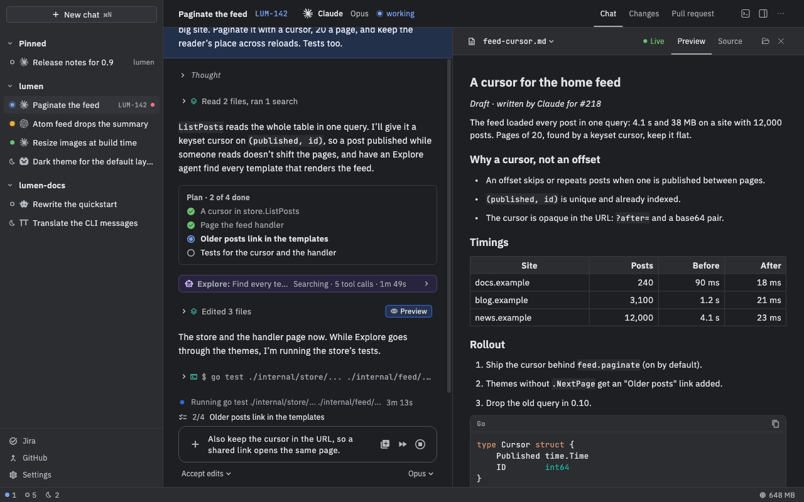
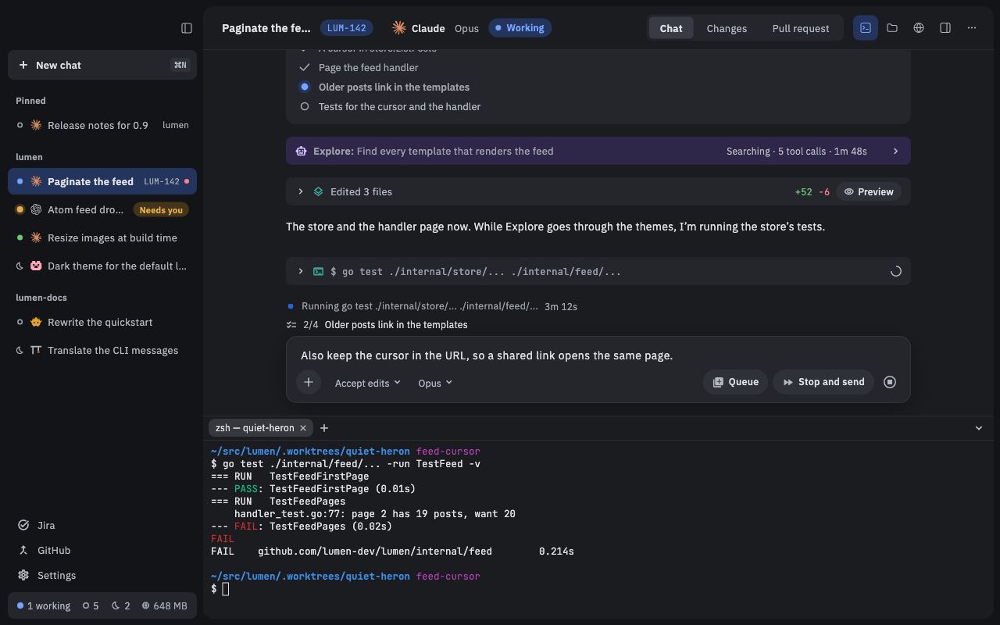

# Previews and terminals

When the agent writes a file, such as a report, a web page or a diagram, you can see it right next to the chat, and it updates as the agent changes it. Each chat can also have its own terminals, so you can run commands in the chat's folder without leaving Nushi.

Shortcuts below are the Mac's. On Linux, use Ctrl where the Mac uses ⌘, and Alt where it uses ⌥. Terminals use different keys on Linux; they're given where they come up.

## Open a preview

When the agent writes a document, page, image or diagram, its row in the chat has a **Preview** button. Click it and the file opens beside the chat. Where the row is narrow (a subagent's pane), the button is inside the row: click the row to open it first.

You can also open files in these ways:

- **Artifacts**: in the details panel (the panel button in the chat's header), the **Artifacts** list shows the documents, pages and images the chat made. Click one to open it.
- **Open file** (⌘P): type part of a name to open any file in the chat's folder, code included.
- **Files** (⇧⌘E, or the folder button in the header): a tree of the chat's folder. Files the chat wrote have a dot.

Some agents can also open a file, or a page on your own machine, in the preview themselves.

## What you can preview

- **Markdown**, rendered. Long documents get a small outline on the left; point at it to jump to a heading.
- **HTML pages and SVG**, shown as a web page. Use **Reload**, or **Open in browser** to view it in your normal browser.
- **Images** and **PDFs**.
- **CSV files**, as a table (the first 500 rows).
- **Mermaid diagrams** (`.mmd` or `.mermaid` files). Mermaid blocks in the agent's messages draw as diagrams too.
- **Code and text files**, with syntax highlighting.

Above the file is its path. Click the path to copy it.

## Work with several files

Opening a second file adds a tab at the top of the pane.

- Click a name to switch to that file.
- Click a tab's **✕**, or press ⌘W, to close it. Closing the last tab closes the pane, and closing the pane closes all its tabs.

## Edit a file

You can edit any file that shows as text. For Markdown, HTML, SVG, CSV and diagrams, first click the **`</>`** button at the right of the path line (**View source**). Click **View preview** to go back.

1. Click in the text and type. There's no Edit button.
2. Press ⌘S to save. Clicking into the message box or a terminal saves too.

A dot by the file's name means unsaved changes. With your next message, the agent is told you edited the file.

If the agent changes the lines you're editing, you'll see **Changed on disk**, with **Compare**, **Overwrite with mine** and **Use theirs**.

## Use the browser

A browser tab shows a web page beside the chat, such as the dev server the agent just started.

1. Click the globe in the chat's header (**Show browser**), or choose **New browser tab** from the palette (⌘K).
2. Type an address and press Return. `localhost:3000`, or just `3000`, works for a local server.

The bar has Back, Forward and Reload (⌘R). ⌘L jumps to the address field. **Expand** gives the browser the whole chat area, and **Collapse** gives the chat back.

If your project lists dev servers in a launch file (`.claude/launch.json` or `.agents/launch.json`), the **Servers** button starts and stops them. **Logs** shows a server's output.

## Open a terminal

Each chat has its own terminals, in tabs under the chat. They start in the chat's folder, using your normal login shell.

1. Click the terminal button in the chat's header, or press ⌃\`.
2. Press ⌘T (Ctrl+Shift+T on Linux), or click the **+** after the tabs, for another terminal.
3. Press ⌘W (Ctrl+Shift+W on Linux) to close the terminal you're in. Press ⌃\` again to hide the panel.

Terminals keep running after you quit the app, because Nushi's background service (the daemon) keeps them. Reopen the app and they're still there.

## Run a command from the chat

When the agent suggests a shell command in a code block, click **▷** next to the copy button. Nushi types it into one of the chat's terminals for you. When it finishes, a card with the output appears in the message box, and goes to the agent with your next message. To leave it out, point at the card and click its **✕**.

## Good to know

- ⌥⌘1 to ⌥⌘9 switch between terminals, and ⌘F searches a terminal's scrollback. On Linux, use Alt+1 to Alt+9 and Ctrl+Shift+F.
- Restarting the daemon closes your terminals. Archiving or deleting a chat closes its terminals too.
- On Linux, HTML pages, SVG, PDFs and browser tabs show a placeholder with an **Open in** button for your default browser. Mermaid diagrams show as source, in files and in messages.
- Some files are read-only in the preview, for example files over 1 MB or files you don't have permission to write. The reason shows above the text.
- ⌥Z turns line wrapping on or off in a code preview.
- On the [Phone](Phone), previews open full screen, with no tabs and no editing.
