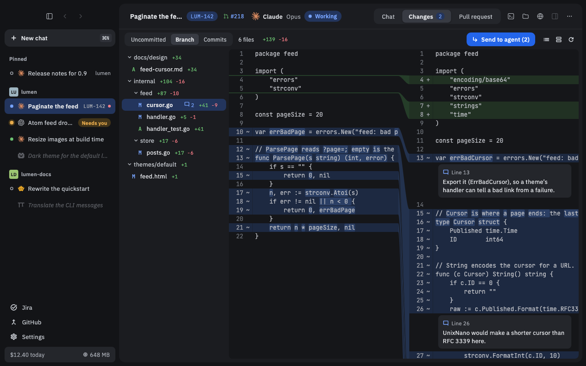

# Reviewing changes

Every chat has a **Changes** tab that shows what the agent changed in your code. Read the diff, leave comments on lines for the agent to fix, and commit when you're happy.

## See what the agent changed

1. Open a chat.
2. Click **Changes** in the chat's header, beside **Chat** (or press ⌃⌘2). To move between the chat's tabs, press ⌃Tab for the next one and ⌃⇧Tab for the one before, as in a browser. ⇧⌘] and ⇧⌘[ work too while those two keep their own keys, and so do **View › Next Tab** and **Previous Tab**.
3. Pick a file in the list on the left to see its diff.

The tabs in the bar at the top pick what you see:

- **Uncommitted**: changes not yet committed.
- **Branch**: everything on the chat's branch since it left its base branch.
- **Commits**: the branch's commits, one at a time.

The view refreshes each time the agent finishes a turn. To refresh it at any time, click the reload button in the bar.

## Side by side or unified

The button in the bar switches between two views:

- **Side by side**: old code on the left, new code on the right.
- **Unified**: one column, removed lines above the added ones.

You can also use **View › Show Diffs Unified**. Your choice applies to every diff in Nushi, and Nushi remembers it.

## Copy code from a diff

Select code in any diff and copy it, as in an editor: in Changes, a pull request's files, or a tool call in the chat.

1. Drag across the code. Double-click selects a word, triple-click a line, and Shift-click extends the selection.
2. Press ⌘C (Ctrl+C on Linux and Windows), or right-click the code and pick **Copy**.

You get the code as it shows, without the line numbers or the + and - marks. Escape or a click elsewhere in the diff clears the selection. Selecting code never opens a comment: comments start from the line numbers. On the phone a drag scrolls the diff instead.

## Comment on lines

Leave comments for the agent, as in a code review.

1. Hover over a line and click the blue **+** at its start, or click a line number. To comment on several lines, drag across them from the **+** or the line numbers.
2. Type your comment and click **Comment**.
3. Add as many comments as you like, across any files.

The tab shows how many comments you haven't sent yet (**Changes 2**). To edit a comment, hover over it and click the pencil. To remove it, click ✕.

## Send your comments to the agent

1. Click **Send to agent** in the Changes bar. It shows how many comments you have, such as **Send to agent (2)**.
2. Nushi takes you back to the chat. Your comments are now in the message box as cards.
3. Add a note if you like, then send. The agent gets all your comments in one message.

Once the agent changes the lines you commented on, your sent comments leave the diff. A small **2 sent** pill above the file says they were there. Click it to read them, or click ✕ to remove one. They go by themselves when the agent's turn ends.

When a message has two or more cards, each shows a number (1, 2, 3) in the box and in the sent message. The agent sees the same numbers, so its "#2" is your second card.

If you go back to the chat before you send them, a line above the message box reminds you that the comments aren't sent yet. It has **Send to agent** and **Show** links.

## Commit

You can commit from the Changes tab, in **Uncommitted**:

1. Tick the checkbox beside each file or folder you want to commit (this stages it).
2. Write a message in the **Commit message** box under the list. With some agents, the ✨ button writes the message for you. You can edit it.
3. Click the commit button, which counts what you staged (**Commit 2 files**), or press ⌘⏎ in the message box.

Commits use your own git setup: your name, signing and hooks. Nushi never pushes. To push, use a terminal or ask the agent.

## Work in a worktree

A worktree is a separate copy of your repository on its own branch. The agent's work in it doesn't mix with yours.

To start a chat in one:

1. Start a new chat in a git repository ([Your first chat](Getting-started)).
2. Before you send the first message, turn on **New worktree** under the message box.

Nushi makes a new branch for the chat. After the first turn, it names the branch after the chat's title. For a worktree chat, **Branch** shows all of the chat's work, committed or not.

To move a chat that already has messages into a new worktree, open the **Worktree** row in the details panel's **Environment** widget and pick **New worktree…**. Uncommitted changes stay where they were. A move waits until the agent is done, including a prompt still waiting for your answer: answer or stop it first.

## Clean up a worktree

When you're done with a worktree chat, pick **Clean up…** from the chat's ⋯ menu (or **Chat › Clean Up…** in the menu bar). A dialog lists what Nushi can remove, each with a checkbox:

- **Delete the worktree**
- **Delete the local branch**
- **Delete the branch on GitHub** (when the chat has a pull request)
- **Archive this chat**

Anything that would lose work, like uncommitted files, starts unticked. If you tick it, the button tells you what you'll lose before you confirm.

When a chat's pull request is merged or closed, the details panel's **Pull request** widget offers **Clean up…** too. See [GitHub](GitHub) for pull requests.

## Good to know

- To find text across the changed files and diffs, press ⌘F in the Changes tab.
- If the agent is still working when you commit, Nushi warns you that files may change.
- If something else staged files after you looked (the agent, for example), **Commit** refuses, so you can check them first.
- If you remove a comment's card from the message box before sending, the comment is gone for good.
- When the agent's subagents work in their own worktrees, the details panel's **Worktrees** widget lists those still there, and a menu at the left of the bar lets you look at any of them. You can comment there, but you can't commit. Worktrees that are gone fold under one line in the widget, such as "2 removed, 1 merged": open it to see each, marked **Removed** or **Merged, removed** (one still there and merged says **Merged**). A squash merge reads as merged once its pull request on GitHub is.
- A workflow's subagents count too: a worktree Claude gave one of them, or one they wrote a file in, shows in the same list. Each row shows a dot while its subagent works, or for a workflow's worktree while the run works, and a check once it's done; hover a workflow's row for the run's name. A worktree only the agent itself works in, or one a workflow's subagent uses only through shell commands, isn't listed.
- On Linux and Windows, use Ctrl where the Mac uses ⌘. ⌃⌘2 is Ctrl+Alt+2 on Linux and Ctrl+Shift+2 on Windows.
