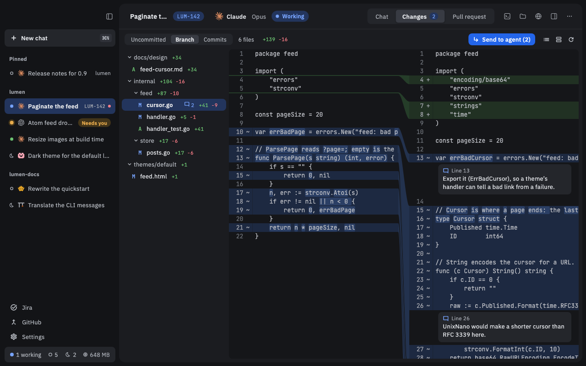

# Reviewing changes

Every chat has a **Changes** tab that shows what the agent changed in your code. You can read the diff, leave comments on lines for the agent to fix, and commit when you're happy.

## See what the agent changed

1. Open a chat.
2. Click **Changes** in the chat's header, beside **Chat** (or press ⌃⌘2).
3. Pick a file in the list on the left to see its diff.

The tabs in the bar at the top pick what you see:

- **Uncommitted**: changes not yet committed.
- **Branch**: everything on the chat's branch since it left its base branch.
- **Commits**: the branch's commits, one at a time.

The view refreshes each time the agent finishes a turn. The reload button in the bar refreshes it any time.

## Side by side or unified

The button in the bar switches between two views:

- **Side by side**: old code on the left, new code on the right.
- **Unified**: one column, removed lines above the added ones.

You can also use **View › Show Diffs Unified**. Your choice applies to every diff in Nushi and is remembered.

## Comment on lines

You can leave comments for the agent, like a code review.

1. Click a line number in the diff, or drag across several.
2. Type your comment and click **Comment**.
3. Add as many comments as you like, across any files.

Unsent comments show as a count on the tab (**Changes 2**). Hover a comment to edit it (pencil) or remove it (✕).

## Send your comments to the agent

1. Click **Send to agent** in the Changes bar. It shows how many comments you have, like **Send to agent (2)**.
2. Nushi takes you back to the chat. Your comments are now in the message box as cards.
3. Add a note if you want, then send. The agent gets all your comments in one message.

If you go back to the chat before sending, a line above the message box reminds you that comments aren't sent yet, with **Send to agent** and **Show** links.

## Commit

In **Uncommitted**, you can commit right from the Changes tab:

1. Tick the checkbox beside each file or folder you want to commit (this stages it).
2. Write a message in the **Commit message** box under the list. With some agents, the ✨ button writes the message for you, and you can edit it.
3. Click the commit button, which counts what you staged (**Commit 2 files**), or press ⌘⏎ in the message box.

Commits use your own git setup: your name, signing and hooks. Nushi never pushes. Push from a terminal, or ask the agent to.

## Work in a worktree

A worktree is a separate copy of your repository on its own branch, so the agent's work doesn't mix with yours.

To start a chat in one:

1. Start a new chat in a git repository ([Your first chat](Getting-started)).
2. Before you send the first message, turn on **New worktree** under the message box.

Nushi makes a new branch for the chat and, after the first turn, names it after the chat's title. For a worktree chat, **Branch** shows all of the chat's work, committed or not.

To move a chat that already has messages into a new worktree, open the **Worktree** row in the details panel's **Environment** widget and pick **New worktree…**. Uncommitted changes stay where they were.

## Clean up a worktree

When you're done with a worktree chat, pick **Clean up…** from the chat's ⋯ menu (or **Chat › Clean Up…** in the menu bar). A dialog lists what it can remove, each with a checkbox:

- **Delete the worktree**
- **Delete the local branch**
- **Delete the branch on GitHub** (when the chat has a pull request)
- **Archive this chat**

Anything that would lose work, like uncommitted files, starts unticked. If you tick it, the button says what you'll lose before you confirm.

When a chat's pull request is merged or closed, the details panel's **Pull request** widget offers **Clean up…** too. See [GitHub](GitHub) for pull requests.

## Good to know

- Press ⌘F in the Changes tab to find text across the changed files and diffs.
- If the agent is still working when you commit, Nushi warns you that files may change.
- If something else staged files after you looked (the agent, for example), **Commit** refuses so you can check them first.
- If you remove a comment's card from the message box before sending, the comment is gone for good.
- When the agent's helpers (subagents) work in their own worktrees, a menu at the left of the bar lets you look at those too. You can comment there, but not commit.
- On Linux, use Ctrl where the Mac uses ⌘. ⌃⌘2 is Ctrl+Alt+2.
